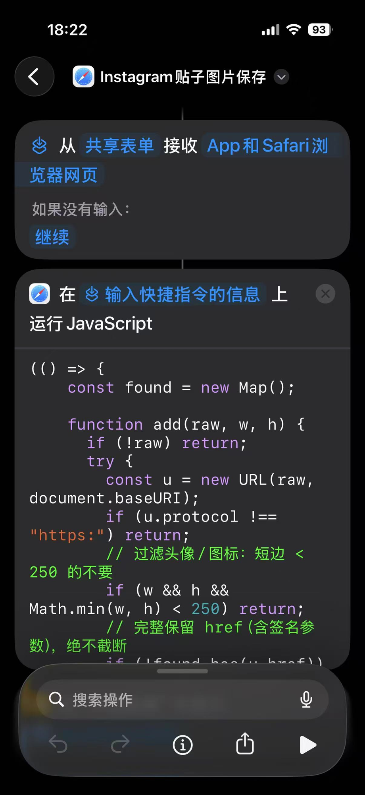
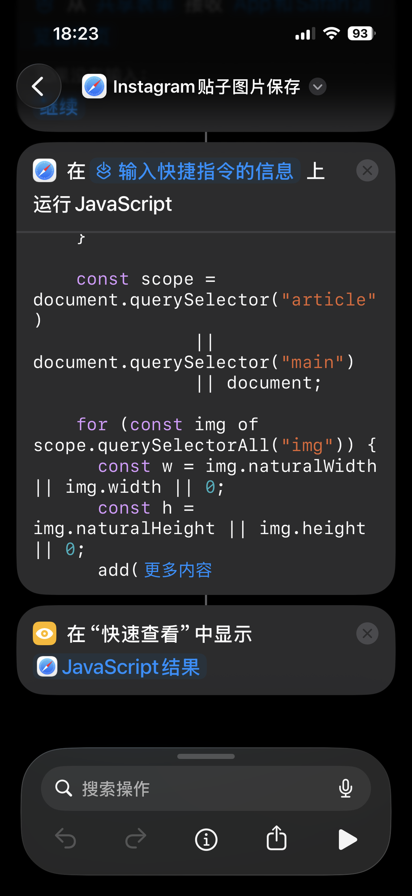
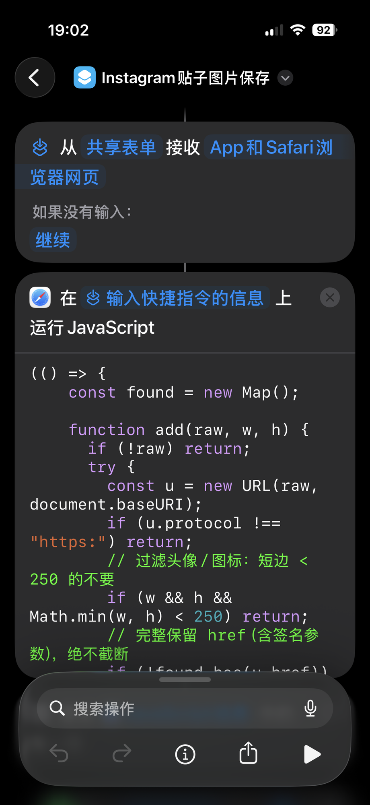
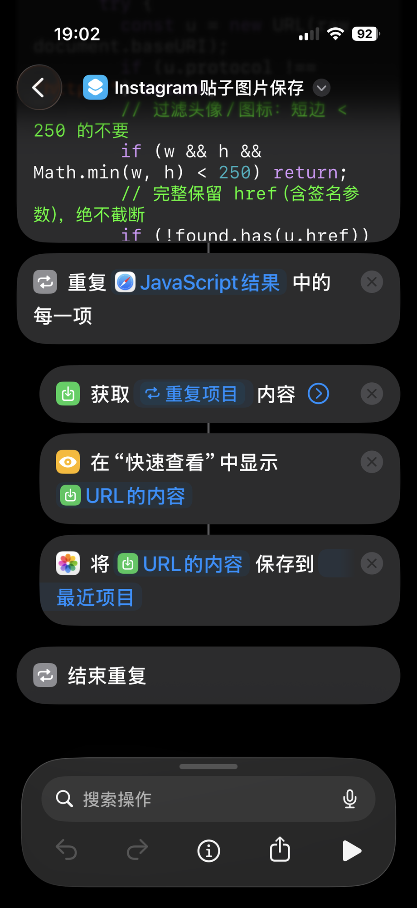
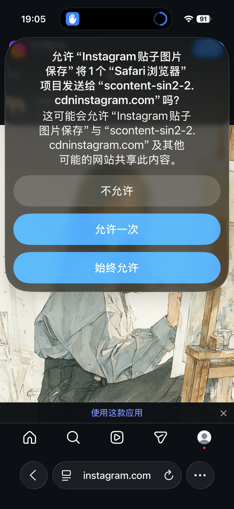
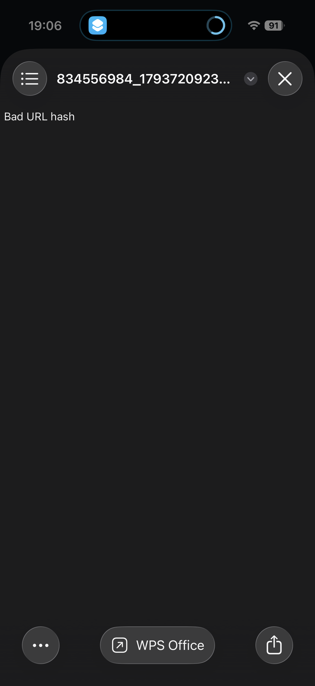

# 逐轮对话完整记录：iPhone 快捷指令批量下载 Instagram 图片（配套逐字稿）

> **日期**：2026-10-09
> **本文定位**：[2026-10-09-iphone-shortcut-instagram-image-saver.md](./2026-10-09-iphone-shortcut-instagram-image-saver.md)（经验总结版）的**配套逐字记录**——所有对话原文一字不漏，截图原样内嵌。
> **内容构成**：
> - **第一部分**：ChatGPT 对话全文（来自分享链接 `chatgpt.com/share/6ac8a15a-d448-83e8-9e0d-5297980b5b63` 的解码重建，共 39 条有效消息。流式重复版本已去重；ChatGPT 自定义 UI 组件标签（`<box>`、`<CodeBlock>`、`<AsyncImage>` 等）原样保留，它们是原文的一部分；分享页重建不含图片，当时用户发给 ChatGPT 的截图未存于分享数据中）
> - **第二部分**：Claude Code 会话逐轮全文（12 轮，含截图内嵌与关键工具记录）
>
> **图片资产**：`assets/2026-10-09-instagram-shortcut/`（8 张截图；其中轮 5 的两张与轮 4 为同内容重发，仅顺序对调，文件大小可证）

---

# 第一部分：ChatGPT 对话全文

# 快捷指令下载图片

> 共 39 条消息（去重后），来源: https://chatgpt.com/share/6ac8a15a-d448-83e8-9e0d-5297980b5b63


---

## user  ·  2026-10-09 10:27

我想开发一个程序放到我的iphone上给一个地址帮我下载地址中涉及到的所有图片给我，但是我又不想走开发app来实现，通过什么方式可以简单快速实现呢

---

## assistant  ·  2026-10-09 10:27

你的需求其实很适合用 **iPhone「快捷指令」+ 一个图片提取脚本** 来实现，不需要开发原生 iOS App，也不需要安装 Xcode。

你想实现的效果大致是：

1. 在 iPhone 上复制一个网页地址，或者在 Safari 中点击分享。
2. 程序自动读取这个网页涉及的图片。
3. 尽可能提取页面中的所有图片，包括正文配图、封面图等。
4. 自动批量下载，并保存到 iPhone 的「照片」或「文件」中。

这里有一个关键区别：**网页里能看到的图片，不一定都直接写在网页 HTML 中。** 有些网站使用懒加载、动态加载、登录验证或 JavaScript 渲染，因此选择合适的实现方式很重要。

## 我推荐的 3 种方案

<box gap={3}>
  <row align=start gap={3}>
    <AsyncImage query="Apple iPhone Shortcuts app icon colorful" aspectRatio="3:4" maxWidth="84px"/>
    <box flex="1" gap={1}>
      **方案一：快捷指令 + 在线图片提取服务**

      <badge color="success">最快上手</badge>

      在 iPhone 上创建一个快捷指令，接收网页 URL，调用图片提取接口，再下载图片。

      - 不需要 Xcode，也不需要开发 App。
      - 可以从 Safari 分享菜单直接启动。
      - 适合普通网页，但取决于提取服务的能力和接口限制。
    </box>
  </row>
  <divider color="subtle"/>
  <row align=start gap={3}>
    <AsyncImage query="Pythonista iOS Python programming app code editor iPhone" aspectRatio="3:4" maxWidth="84px"/>
    <box flex="1" gap={1}>
      **方案二：iPhone 本地脚本**

      在 iPhone 上通过支持 Python 或 JavaScript 的脚本工具运行下载程序，再通过系统分享菜单或文件管理器保存图片。

      - 可以自定义图片筛选规则、去重、文件命名。
      - 部分工作可离线完成，但获取网页内容通常仍需要联网。
      - 需要安装脚本运行工具，且 iOS 对后台下载、文件访问有一定限制。
    </box>
  </row>
  <divider color="subtle"/>
  <row align=start gap={3}>
    <AsyncImage query="Apple MacBook Safari browser developer terminal Python script" aspectRatio="3:4" maxWidth="84px"/>
    <box flex="1" gap={1}>
      **方案三：Mac 负责提取，iPhone 负责接收**

      在你的 Mac 上运行一个轻量网页工具：输入地址后自动提取并打包图片，再通过 iCloud Drive、AirDrop 或局域网传给 iPhone。

      - 最适合需要下载大量图片、处理复杂网页的情况。
      - 可以使用 Python、Playwright 等工具处理动态网页。
      - 不需要开发 iPhone App，但 Mac 需要运行下载程序。
    </box>
  </row>
</box>

## 如果是我来做，我会选这个组合

**iPhone 快捷指令 + Scriptable。**

<box border radius="xl" padding={3} gap={3}>
  <row align="center" gap={2}>
    <AsyncImage query="Scriptable iOS app icon black background yellow script glyph" aspectRatio="1:1" maxWidth="60px"/>
    <box flex="1" gap={1}>
      **Scriptable**
      <text color="secondary" size="sm">iPhone 上运行 JavaScript 脚本的工具</text>
      <text>官网：[scriptable.app](https://scriptable.app/)</text>
    </box>
  </row>
  <divider color="subtle"/>
  <text weight="medium">实际使用流程</text>
  <box background="surface-secondary" radius="lg" padding={3} align="center" gap={1}>
    <icon name="link" size="xl"/>
    **Safari 分享网页地址**
    <icon name="arrow-down" color="secondary" size="lg"/>
    <icon name="code" size="xl"/>
    **脚本解析网页中的图片链接**
    <icon name="arrow-down" color="secondary" size="lg"/>
    <icon name="download" size="xl"/>
    **批量下载、去重、过滤小图**
    <icon name="arrow-down" color="secondary" size="lg"/>
    <icon name="images" size="xl"/>
    **保存到「照片」或「文件」**
  </box>
  <text color="secondary" size="sm">这不是原生 App 开发，不需要 Xcode。普通网页可以先用简单的 HTML 解析实现；遇到动态加载、登录墙或反爬限制时，需要额外处理。</text>
</box>

后续还可以增加一些实用功能：

- 自动排除图标、头像和小尺寸缩略图。
- 自动过滤重复图片。
- 尽量提取原图，而不是网页中的压缩预览图。
- 将所有图片放进同一个文件夹。
- 显示下载进度，并允许失败后重试。

**不过，我想先确认一个关键问题：你主要要下载哪一类网站里的图片？** 这会直接决定用最简单的脚本能不能满足你的需求。

{@body const [site,setSite] = DIL.useState("普通网页")}
{@body const [runMode,setRunMode] = DIL.useState("纯 iPhone")}
{@body const [saveTo,setSaveTo] = DIL.useState("照片")}
<box border radius="xl" padding={4} gap={4}>
  <text weight="medium">1. 图片主要来自哪里？</text>
  <radio-group value={site} onChange={setSite} direction="col">
    <radio value="普通网页">普通网站、文章页面、博客</radio>
    <radio value="Pinterest">Pinterest 图片页面</radio>
    <radio value="社交媒体">Instagram、小红书等社交平台</radio>
    <radio value="图集网站">摄影网站、图库、漫画或图集网站</radio>
    <radio value="任意网页">任意网页，只要能找到的图片都尽量下载</radio>
  </radio-group>
  <divider color="subtle"/>
  <text weight="medium">2. 你希望在哪里运行？</text>
  <radio-group value={runMode} onChange={setRunMode} direction="col">
    <radio value="纯 iPhone">完全在 iPhone 上操作，不依赖 Mac</radio>
    <radio value="Mac 辅助">可以让 Mac 帮忙处理，iPhone 负责接收</radio>
  </radio-group>
  <divider color="subtle"/>
  <text weight="medium">3. 图片保存到哪里？</text>
  <radio-group value={saveTo} onChange={setSaveTo} direction="col">
    <radio value="照片">iPhone「照片」App</radio>
    <radio value="文件">「文件」App，最好自动创建文件夹</radio>
    <radio value="两者都要">两者都要</radio>
  </radio-group>
  <button block onClick={() => GenUI.issueNewTurn("请为我设计一个不开发原生 iOS App 的网页图片批量下载方案。图片来源："+site+"；运行方式："+runMode+"；保存位置："+saveTo+"。优先选择实现简单、能在 iPhone 上直接使用的方案，并提供具体配置步骤和可直接运行的代码。")}>按我的需求设计方案</button>
</box>

---

## assistant  ·  2026-10-09 10:27

## 如果是我来做，我会选这个组合

**iPhone 快捷指令 + Scriptable。**

<box border radius="xl" padding={3} gap={3}>
  <row align="center" gap={2}>
    <AsyncImage query="Scriptable iOS app icon black background yellow script glyph" aspectRatio="1:1" maxWidth="60px"/>
    <box flex="1" gap={1}>
      **Scriptable**
      <text color="secondary" size="sm">iPhone 上运行 JavaScript 脚本的工具</text>
      <text>官网：[scriptable.app](https://scriptable.app/)</text>
    </box>
  </row>
  <divider color="subtle"/>
  <text weight="medium">实际使用流程</text>
  <box background="surface-secondary" radius="lg" padding={3} align="center" gap={1}>
    <icon name="link" size="xl"/>
    **Safari 分享网页地址**
    <icon name="arrow-down" color="secondary" size="lg"/>
    <icon name="code" size="xl"/>
    **脚本解析网页中的图片链接**
    <icon name="arrow-down" color="secondary" size="lg"/>
    <icon name="download" size="xl"/>
    **批量下载、去重、过滤小图**
    <icon name="arrow-down" color="secondary" size="lg"/>
    <icon name="images" size="xl"/>
    **保存到「照片」或「文件」**
  </box>
  <text color="secondary" size="sm">这不是原生 App 开发，不需要 Xcode。普通网页可以先用简单的 HTML 解析实现；遇到动态加载、登录墙或反爬限制时，需要额外处理。</text>
</box>

后续还可以增加一些实用功能：

- 自动排除图标、头像和小尺寸缩略图。
- 自动过滤重复图片。
- 尽量提取原图，而不是网页中的压缩预览图。
- 将所有图片放进同一个文件夹。
- 显示下载进度，并允许失败后重试。

**不过，我想先确认一个关键问题：你主要要下载哪一类网站里的图片？** 这会直接决定用最简单的脚本能不能满足你的需求。

{@body const [site,setSite] = DIL.useState("普通网页")}
{@body const [runMode,setRunMode] = DIL.useState("纯 iPhone")}
{@body const [saveTo,setSaveTo] = DIL.useState("照片")}
<box border radius="xl" padding={4} gap={4}>
  <text weight="medium">1. 图片主要来自哪里？</text>
  <radio-group value={site} onChange={setSite} direction="col">
    <radio value="普通网页">普通网站、文章页面、博客</radio>
    <radio value="Pinterest">Pinterest 图片页面</radio>
    <radio value="社交媒体">Instagram、小红书等社交平台</radio>
    <radio value="图集网站">摄影网站、图库、漫画或图集网站</radio>
    <radio value="任意网页">任意网页，只要能找到的图片都尽量下载</radio>
  </radio-group>
  <divider color="subtle"/>
  <text weight="medium">2. 你希望在哪里运行？</text>
  <radio-group value={runMode} onChange={setRunMode} direction="col">
    <radio value="纯 iPhone">完全在 iPhone 上操作，不依赖 Mac</radio>
    <radio value="Mac 辅助">可以让 Mac 帮忙处理，iPhone 负责接收</radio>
  </radio-group>
  <divider color="subtle"/>
  <text weight="medium">3. 图片保存到哪里？</text>
  <radio-group value={saveTo} onChange={setSaveTo} direction="col">
    <radio value="照片">iPhone「照片」App</radio>
    <radio value="文件">「文件」App，最好自动创建文件夹</radio>
    <radio value="两者都要">两者都要</radio>
  </radio-group>
  <button block onClick={() => GenUI.issueNewTurn("请为我设计一个不开发原生 iOS App 的网页图片批量下载方案。图片来源："+site+"；运行方式："+runMode+"；保存位置："+saveTo+"。优先选择实现简单、能在 iPhone 上直接使用的方案，并提供具体配置步骤和可直接运行的代码。")}>按我的需求设计方案</button>
</box>

---

## user  ·  2026-10-09 10:41

请为我设计一个不开发原生 iOS App 的网页图片批量下载方案。图片来源：社交媒体；运行方式：纯 iPhone；保存位置：照片。优先选择实现简单、能在 iPhone 上直接使用的方案，并提供具体配置步骤和可直接运行的代码。

---

## tool  ·  2026-10-09 10:41

The output of this plugin was redacted.

---

## tool  ·  2026-10-09 10:41

The output of this plugin was redacted.

---

## assistant  ·  2026-10-09 10:41

我建议你采用 **Scriptable + iPhone 分享菜单 + Safari 网页解析** 这条路线。它不需要 Xcode、不需要 Mac，也不需要自己开发和安装原生 App。

但针对 Instagram、小红书、Pinterest 等社交媒体，有一个重要限制：**普通脚本能提取网页公开提供的图片链接，却不一定能获取平台实际加载的全部原图。** 登录、动态加载、反爬机制以及平台自身限制都会影响结果。

Scriptable 支持从系统分享菜单接收 URL，也能调用 iOS 的照片图库接口保存图片，因此很适合做这个轻量工具。<Cite refs={["turn602835search2","turn602835search3","turn602835search4"]}/>

## 一、先把工具准备好

<box gap={3}>
  <row align="start" gap={3}>
    <AsyncImage query="Scriptable iPhone app icon yellow script black background" aspectRatio="1:1" maxWidth="76px"/>
    <box flex="1" gap={1}>
      **1. 安装 Scriptable**

      打开 [Scriptable 官网](https://scriptable.app/)，通过 App Store 安装。

      <text color="secondary" size="sm">免费使用基础脚本功能；首次保存图片时需要授权照片图库访问。</text>
    </box>
  </row>
  <row align="start" gap={3}>
    <AsyncImage query="Apple Safari iOS app icon blue compass white background" aspectRatio="1:1" maxWidth="76px"/>
    <box flex="1" gap={1}>
      **2. 用 Safari 打开目标社交媒体页面**

      优先使用 Safari 中可直接访问的公开网页。先不要从社交媒体 App 内的分享链接开始，因为有些链接只是跳转链接，未必是实际图片页面。
    </box>
  </row>
</box>


---

## assistant  ·  2026-10-09 10:41

## 二、创建「网页图片批量保存」快捷指令

这一步直接使用 iPhone 自带的「快捷指令」App，不需要额外编写完整 App。我们让 Safari 负责读取当前网页已经加载出来的图片，再让快捷指令负责下载和保存。

### 第 1 步：创建快捷指令

打开「快捷指令」→ 右上角 `+`，将名称设置为：

`网页图片批量保存`

打开快捷指令的详细信息，将其设置为可以在共享表单中显示，并允许接收 Safari 网页输入或网页 URL。苹果说明了共享表单可以向快捷指令传入网页、URL 等不同类型的数据。<Cite refs={["turn602835search7","turn602835search16"]}/>

### 第 2 步：添加「在网页上运行 JavaScript」

在动作搜索框中搜索：

`在网页上运行 JavaScript`

英文系统中通常叫 `Run JavaScript on Webpage`。

把下面代码粘贴到该动作的代码区域：

<CodeBlock language="javascript" editable>
const results = new Set();

function addURL(value) {
  if (!value) return;

  try {
    const url = new URL(value, document.baseURI);

    if (
      url.protocol !== "https:" &&
      url.protocol !== "http:"
    ) return;

    if (url.hostname === location.hostname &&
        url.pathname.endsWith(".svg")) return;

    results.add(url.href);
  } catch (e) {}
}

// 提取页面中的图片
for (const img of document.querySelectorAll("img")) {
  const rect = img.getBoundingClientRect();

  // 过滤明显的小图标；对尚未滚动到的图片不过度过滤
  if (
    img.naturalWidth > 0 &&
    img.naturalHeight > 0 &&
    img.naturalWidth < 120 &&
    img.naturalHeight < 120
  ) continue;

  addURL(img.currentSrc);
  addURL(img.src);
  addURL(img.dataset.src);
  addURL(img.dataset.original);
  addURL(img.dataset.lazySrc);

  // 提取 srcset 中的图片地址
  const srcset = img.getAttribute("srcset") || "";
  for (const item of srcset.split(",")) {
    const candidate = item.trim().split(/\s+/)[0];
    addURL(candidate);
  }
}

// 提取网页分享封面
for (const meta of document.querySelectorAll("meta")) {
  const key = (
    meta.getAttribute("property") ||
    meta.getAttribute("name") ||
    ""
  ).toLowerCase();

  if (
    key === "og:image" ||
    key === "twitter:image"
  ) {
    addURL(meta.content);
  }
}

completion(Array.from(results));
</CodeBlock>

这段代码会尝试获取当前页面的图片地址、部分懒加载图片地址、`srcset` 候选图和分享封面，并去除重复链接。它不会破解登录验证，也不会保证提取到网站未加载的图片。

### 第 3 步：添加循环下载和保存动作

在 JavaScript 动作后面，依次添加以下动作：

<box border radius="lg" padding={3} gap={3}>
  <row align="start" gap={3}>
    <box background="surface-secondary" radius="md" size="36px" align="center" justify="center">
      <icon name="list" size="lg"/>
    </box>
    <box flex="1" gap={1}>
      **动作 1：重复每一项（Repeat with Each）**

      输入选择上一个 JavaScript 动作的结果，也就是它返回的图片 URL 列表。
    </box>
  </row>
  <divider color="subtle"/>
  <row align="start" gap={3}>
    <box background="surface-secondary" radius="md" size="36px" align="center" justify="center">
      <icon name="download" size="lg"/>
    </box>
    <box flex="1" gap={1}>
      **动作 2：获取 URL 内容（Get Contents of URL）**

      URL 选择当前的「重复项目」。默认使用 GET 请求即可。
    </box>
  </row>
  <divider color="subtle"/>
  <row align="start" gap={3}>
    <box background="surface-secondary" radius="md" size="36px" align="center" justify="center">
      <icon name="images" size="lg"/>
    </box>
    <box flex="1" gap={1}>
      **动作 3：存储到照片相簿（Save to Photo Album）**

      输入选择上一个动作获取到的图像内容，指定保存到「最近项目」或你想使用的相簿。
    </box>
  </row>
  <divider color="subtle"/>
  <row align="start" gap={3}>
    <box background="surface-secondary" radius="md" size="36px" align="center" justify="center">
      <icon name="check-circle" size="lg"/>
    </box>
    <box flex="1" gap={1}>
      **动作 4：结束重复（End Repeat）**

      放在循环末尾。
    </box>
  </row>
</box>

如果系统要求授权访问网页或照片图库，请确认是你自己创建的快捷指令后再授权。快捷指令中的网页 JavaScript 只能在受支持的活动 Safari 网页中运行。<Cite refs={["turn602835search16","turn602835search3"]}/>


---

## assistant  ·  2026-10-09 10:41

我建议你采用 **Scriptable + iPhone 分享菜单 + Safari 网页解析** 这条路线。它不需要 Xcode、不需要 Mac，也不需要自己开发和安装原生 App。

但针对 Instagram、小红书、Pinterest 等社交媒体，有一个重要限制：**普通脚本能提取网页公开提供的图片链接，却不一定能获取平台实际加载的全部原图。** 登录、动态加载、反爬机制以及平台自身限制都会影响结果。

Scriptable 支持从系统分享菜单接收 URL，也能调用 iOS 的照片图库接口保存图片，因此很适合做这个轻量工具。<Cite refs={["turn602835search2","turn602835search3","turn602835search4"]}/>

## 一、先把工具准备好

<box gap={3}>
  <row align="start" gap={3}>
    <AsyncImage query="Scriptable iPhone app icon yellow script black background" aspectRatio="1:1" maxWidth="76px"/>
    <box flex="1" gap={1}>
      **1. 安装 Scriptable**

      打开 [Scriptable 官网](https://scriptable.app/)，通过 App Store 安装。

      <text color="secondary" size="sm">免费使用基础脚本功能；首次保存图片时需要授权照片图库访问。</text>
    </box>
  </row>
  <row align="start" gap={3}>
    <AsyncImage query="Apple Safari iOS app icon blue compass white background" aspectRatio="1:1" maxWidth="76px"/>
    <box flex="1" gap={1}>
      **2. 用 Safari 打开目标社交媒体页面**

      优先使用 Safari 中可直接访问的公开网页。先不要从社交媒体 App 内的分享链接开始，因为有些链接只是跳转链接，未必是实际图片页面。
    </box>
  </row>
</box>

## 二、创建「网页图片批量保存」快捷指令

这一步直接使用 iPhone 自带的「快捷指令」App，不需要额外编写完整 App。我们让 Safari 负责读取当前网页已经加载出来的图片，再让快捷指令负责下载和保存。

### 第 1 步：创建快捷指令

打开「快捷指令」→ 右上角 `+`，将名称设置为：

`网页图片批量保存`

打开快捷指令的详细信息，将其设置为可以在共享表单中显示，并允许接收 Safari 网页输入或网页 URL。苹果说明了共享表单可以向快捷指令传入网页、URL 等不同类型的数据。<Cite refs={["turn602835search7","turn602835search16"]}/>

### 第 2 步：添加「在网页上运行 JavaScript」

在动作搜索框中搜索：

`在网页上运行 JavaScript`

英文系统中通常叫 `Run JavaScript on Webpage`。

把下面代码粘贴到该动作的代码区域：

<CodeBlock language="javascript" editable>
const results = new Set();

function addURL(value) {
  if (!value) return;

  try {
    const url = new URL(value, document.baseURI);

    if (
      url.protocol !== "https:" &&
      url.protocol !== "http:"
    ) return;

    if (url.hostname === location.hostname &&
        url.pathname.endsWith(".svg")) return;

    results.add(url.href);
  } catch (e) {}
}

// 提取页面中的图片
for (const img of document.querySelectorAll("img")) {
  const rect = img.getBoundingClientRect();

  // 过滤明显的小图标；对尚未滚动到的图片不过度过滤
  if (
    img.naturalWidth > 0 &&
    img.naturalHeight > 0 &&
    img.naturalWidth < 120 &&
    img.naturalHeight < 120
  ) continue;

  addURL(img.currentSrc);
  addURL(img.src);
  addURL(img.dataset.src);
  addURL(img.dataset.original);
  addURL(img.dataset.lazySrc);

  // 提取 srcset 中的图片地址
  const srcset = img.getAttribute("srcset") || "";
  for (const item of srcset.split(",")) {
    const candidate = item.trim().split(/\s+/)[0];
    addURL(candidate);
  }
}

// 提取网页分享封面
for (const meta of document.querySelectorAll("meta")) {
  const key = (
    meta.getAttribute("property") ||
    meta.getAttribute("name") ||
    ""
  ).toLowerCase();

  if (
    key === "og:image" ||
    key === "twitter:image"
  ) {
    addURL(meta.content);
  }
}

completion(Array.from(results));
</CodeBlock>

这段代码会尝试获取当前页面的图片地址、部分懒加载图片地址、`srcset` 候选图和分享封面，并去除重复链接。它不会破解登录验证，也不会保证提取到网站未加载的图片。

### 第 3 步：添加循环下载和保存动作

在 JavaScript 动作后面，依次添加以下动作：

<box border radius="lg" padding={3} gap={3}>
  <row align="start" gap={3}>
    <box background="surface-secondary" radius="md" size="36px" align="center" justify="center">
      <icon name="list" size="lg"/>
    </box>
    <box flex="1" gap={1}>
      **动作 1：重复每一项（Repeat with Each）**

      输入选择上一个 JavaScript 动作的结果，也就是它返回的图片 URL 列表。
    </box>
  </row>
  <divider color="subtle"/>
  <row align="start" gap={3}>
    <box background="surface-secondary" radius="md" size="36px" align="center" justify="center">
      <icon name="download" size="lg"/>
    </box>
    <box flex="1" gap={1}>
      **动作 2：获取 URL 内容（Get Contents of URL）**

      URL 选择当前的「重复项目」。默认使用 GET 请求即可。
    </box>
  </row>
  <divider color="subtle"/>
  <row align="start" gap={3}>
    <box background="surface-secondary" radius="md" size="36px" align="center" justify="center">
      <icon name="images" size="lg"/>
    </box>
    <box flex="1" gap={1}>
      **动作 3：存储到照片相簿（Save to Photo Album）**

      输入选择上一个动作获取到的图像内容，指定保存到「最近项目」或你想使用的相簿。
    </box>
  </row>
  <divider color="subtle"/>
  <row align="start" gap={3}>
    <box background="surface-secondary" radius="md" size="36px" align="center" justify="center">
      <icon name="check-circle" size="lg"/>
    </box>
    <box flex="1" gap={1}>
      **动作 4：结束重复（End Repeat）**

      放在循环末尾。
    </box>
  </row>
</box>

如果系统要求授权访问网页或照片图库，请确认是你自己创建的快捷指令后再授权。快捷指令中的网页 JavaScript 只能在受支持的活动 Safari 网页中运行。<Cite refs={["turn602835search16","turn602835search3"]}/>

## 三、实际使用方法

<box gap={2}>
  <row align="center" gap={3}>
    <AsyncImage query="Instagram public profile post viewed in Safari iPhone" aspectRatio="3:4" maxWidth="88px"/>
    <box flex="1" gap={1}>
      **1. 在 Safari 中打开社交媒体网页**

      例如打开一个公开的图集或帖子，等图片加载出来。
    </box>
  </row>
  <row align="center" gap={3}>
    <AsyncImage query="iPhone Safari iOS share sheet Run Shortcut action" aspectRatio="3:4" maxWidth="88px"/>
    <box flex="1" gap={1}>
      **2. 点击分享按钮**

      在分享菜单中选择「网页图片批量保存」。
    </box>
  </row>
  <row align="center" gap={3}>
    <AsyncImage query="iPhone Photos app recent photos grid saved images" aspectRatio="3:4" maxWidth="88px"/>
    <box flex="1" gap={1}>
      **3. 检查照片图库**

      等待循环执行完毕，查看「照片」App 中保存的图片。
    </box>
  </row>
</box>

## 四、社交媒体的实际限制

| 网站类型 | 预计效果 |
|---|---|
| 普通公开图集网页 | 通常较好 |
| Pinterest 公开 Pin 页面 | 可能提取到封面或当前加载的图片 |
| Instagram 公开帖子 | 取决于 Safari 实际加载的内容 |
| 小红书帖子 | 可能受到登录、动态加载和访问限制影响 |
| 需要登录或仅 App 内可见的内容 | 可能无法获取完整图片 |

还有三个注意事项：

- **懒加载：** 页面还没加载的图片可能不会出现在结果里。可以先在网页中向下滚动，加载更多内容，再运行快捷指令。
- **原图质量：** 页面里的图片地址可能指向缩略图，而不是原图。
- **下载失败：** 部分图片链接需要登录 Cookie 或特定请求头。快捷指令重新请求这些链接时可能会失败。

建议先用一个公开图集页面测试几张图片，确认下载和保存流程正常，再测试目标社交媒体。仅下载你有权保存和使用的图片，并遵守相应平台的规则。

## 五、我建议你再做一步优化

目前这版是一个通用起点。如果你主要使用某一个社交媒体，针对它调整图片提取逻辑会更有效。

你最主要想下载的是哪个平台的图片？

{@body const [platform,setPlatform] = DIL.useState("Pinterest")}
{@body const [scope,setScope] = DIL.useState("单个帖子或图集")}
<box border radius="xl" padding={3} gap={3}>
  <radio-group value={platform} onChange={setPlatform} direction="col">
    <radio value="Pinterest">Pinterest：Pin 页面和图片</radio>
    <radio value="Instagram">Instagram：帖子和轮播图</radio>
    <radio value="小红书">小红书：笔记图片</radio>
    <radio value="其他社交媒体">其他社交媒体</radio>
  </radio-group>
  <divider color="subtle"/>
  <text weight="medium">希望下载的范围</text>
  <radio-group value={scope} onChange={setScope} direction="col">
    <radio value="单个帖子或图集">一个帖子或图集中的所有图片</radio>
    <radio value="整个网页">整个网页中加载的所有图片</radio>
    <radio value="多个页面">一个账号或多个页面中的大量图片</radio>
  </radio-group>
  <button block onClick={() => GenUI.issueNewTurn("请继续完善我的纯 iPhone 网页图片批量下载快捷指令，平台是："+platform+"；下载范围是："+scope+"；保存到照片 App；不开发原生 App。请提供针对该平台可行的提取代码、快捷指令动作配置，并明确实际限制。")}>生成针对该平台的版本</button>
</box>

---

## assistant  ·  2026-10-09 10:42

## 三、实际使用方法

<box gap={2}>
  <row align="center" gap={3}>
    <AsyncImage query="Instagram public profile post viewed in Safari iPhone" aspectRatio="3:4" maxWidth="88px"/>
    <box flex="1" gap={1}>
      **1. 在 Safari 中打开社交媒体网页**

      例如打开一个公开的图集或帖子，等图片加载出来。
    </box>
  </row>
  <row align="center" gap={3}>
    <AsyncImage query="iPhone Safari iOS share sheet Run Shortcut action" aspectRatio="3:4" maxWidth="88px"/>
    <box flex="1" gap={1}>
      **2. 点击分享按钮**

      在分享菜单中选择「网页图片批量保存」。
    </box>
  </row>
  <row align="center" gap={3}>
    <AsyncImage query="iPhone Photos app recent photos grid saved images" aspectRatio="3:4" maxWidth="88px"/>
    <box flex="1" gap={1}>
      **3. 检查照片图库**

      等待循环执行完毕，查看「照片」App 中保存的图片。
    </box>
  </row>
</box>

## 四、社交媒体的实际限制

| 网站类型 | 预计效果 |
|---|---|
| 普通公开图集网页 | 通常较好 |
| Pinterest 公开 Pin 页面 | 可能提取到封面或当前加载的图片 |
| Instagram 公开帖子 | 取决于 Safari 实际加载的内容 |
| 小红书帖子 | 可能受到登录、动态加载和访问限制影响 |
| 需要登录或仅 App 内可见的内容 | 可能无法获取完整图片 |

还有三个注意事项：

- **懒加载：** 页面还没加载的图片可能不会出现在结果里。可以先在网页中向下滚动，加载更多内容，再运行快捷指令。
- **原图质量：** 页面里的图片地址可能指向缩略图，而不是原图。
- **下载失败：** 部分图片链接需要登录 Cookie 或特定请求头。快捷指令重新请求这些链接时可能会失败。

建议先用一个公开图集页面测试几张图片，确认下载和保存流程正常，再测试目标社交媒体。仅下载你有权保存和使用的图片，并遵守相应平台的规则。

## 五、我建议你再做一步优化

目前这版是一个通用起点。如果你主要使用某一个社交媒体，针对它调整图片提取逻辑会更有效。

你最主要想下载的是哪个平台的图片？

{@body const [platform,setPlatform] = DIL.useState("Pinterest")}
{@body const [scope,setScope] = DIL.useState("单个帖子或图集")}
<box border radius="xl" padding={3} gap={3}>
  <radio-group value={platform} onChange={setPlatform} direction="col">
    <radio value="Pinterest">Pinterest：Pin 页面和图片</radio>
    <radio value="Instagram">Instagram：帖子和轮播图</radio>
    <radio value="小红书">小红书：笔记图片</radio>
    <radio value="其他社交媒体">其他社交媒体</radio>
  </radio-group>
  <divider color="subtle"/>
  <text weight="medium">希望下载的范围</text>
  <radio-group value={scope} onChange={setScope} direction="col">
    <radio value="单个帖子或图集">一个帖子或图集中的所有图片</radio>
    <radio value="整个网页">整个网页中加载的所有图片</radio>
    <radio value="多个页面">一个账号或多个页面中的大量图片</radio>
  </radio-group>
  <button block onClick={() => GenUI.issueNewTurn("请继续完善我的纯 iPhone 网页图片批量下载快捷指令，平台是："+platform+"；下载范围是："+scope+"；保存到照片 App；不开发原生 App。请提供针对该平台可行的提取代码、快捷指令动作配置，并明确实际限制。")}>生成针对该平台的版本</button>
</box>

---

## user  ·  2026-10-09 11:24

请继续完善我的纯 iPhone 网页图片批量下载快捷指令，平台是：Instagram；下载范围是：单个帖子或图集；保存到照片 App；不开发原生 App。请提供针对该平台可行的提取代码、快捷指令动作配置，并明确实际限制。

---

## user  ·  2026-10-09 11:25

请继续完善我的纯 iPhone 网页图片批量下载快捷指令，平台是：Instagram；下载范围是：单个帖子或图集；保存到照片 App；不开发原生 App。请提供针对该平台可行的提取代码、快捷指令动作配置，并明确实际限制。

---

## tool  ·  2026-10-09 11:25

The output of this plugin was redacted.

---

## tool  ·  2026-10-09 11:25

The output of this plugin was redacted.

---

## assistant  ·  2026-10-09 11:25

针对 Instagram，我建议把上一版再收紧一下：**只提取当前帖子的图片，尽量排除头像和界面图标，再交给快捷指令保存到「照片」App。**

先说明一个实际限制：Instagram 的轮播图不一定会把所有图片同时放进网页 DOM，且图片 CDN 链接有时会失效或要求特定访问条件。因此，下面是一个适合公开帖子测试的版本，不是保证能下载所有 Instagram 帖子的万能工具。

苹果官方确认，快捷指令的「在网页上运行 JavaScript」动作必须接收活动中的 Safari 网页，并通过 `completion(result)` 返回结果；它适合提取页面数据，但不能绕过网站的登录和访问限制。<Cite refs={["turn137785search0","turn137785search1"]}/>

## 1. 创建快捷指令

在 iPhone 上打开「快捷指令」App，新建快捷指令，命名为：

`Instagram 帖子图片保存`

进入快捷指令的详细信息，打开「在共享表单中显示」，输入类型只保留 Safari 网页。

如果首次运行失败，进入「设置」→「快捷指令」→「高级」，开启「允许运行脚本」。不同 iOS 版本的菜单文字可能略有区别。<Cite refs={["turn137785search0"]}/>

## 2. 添加图片提取代码

在快捷指令中添加「在网页上运行 JavaScript」动作，将下面代码完整粘贴进去。

<CodeBlock language="javascript" editable>
(() => {
  const found = new Map();

  function add(raw, width = 0, height = 0) {
    if (!raw) return;

    try {
      const u = new URL(raw, document.baseURI);

      if (u.protocol !== "https:") return;

      // 优先只接受 Instagram 图片 CDN
      const host = u.hostname.toLowerCase();
      const isInstagramCDN =
        host === "cdninstagram.com" ||
        host.endsWith(".cdninstagram.com") ||
        host === "fbcdn.net" ||
        host.endsWith(".fbcdn.net");

      if (!isInstagramCDN) return;

      // 过滤明显过小的头像、图标
      if (width && height && Math.min(width, height) < 250) {
        return;
      }

      const key = u.href;
      if (!found.has(key)) {
        found.set(key, {
          url: key,
          width: width || 0,
          height: height || 0
        });
      }
    } catch (_) {}
  }

  // 尽量优先检查帖子内容区域
  const scope =
    document.querySelector("article") ||
    document.querySelector("main") ||
    document;

  for (const img of scope.querySelectorAll("img")) {
    const w = img.naturalWidth || img.width || 0;
    const h = img.naturalHeight || img.height || 0;

    add(img.currentSrc, w, h);
    add(img.src, w, h);

    // 尝试收集 srcset 中的候选图片
    const srcset = img.getAttribute("srcset") || "";
    for (const item of srcset.split(",")) {
      const candidate = item.trim().split(/\s+/)[0];
      add(candidate, w, h);
    }
  }

  // 补充 Open Graph 封面图
  const og = document.querySelector(
    'meta[property="og:image"]'
  );

  if (og) add(og.content);

  const result = Array.from(found.values())
    .sort((a, b) => (b.width * b.height) - (a.width * a.height))
    .map(item => item.url);

  completion(result);
})();
</CodeBlock>

这段代码的特点：

- 只保留常见的 Instagram/Facebook 图片 CDN 地址。
- 优先检查帖子或主要内容区域。
- 尽量排除明显过小的图片。
- 去除完全相同的 URL，并优先排列尺寸较大的图片。

需要注意：Instagram 会调整 CDN 域名和网页结构。若某张图片不在这些域名下，代码就会跳过它；这时应先检查页面实际返回的图片 URL，而不是直接放宽所有过滤条件。

## 3. 配置下载与保存动作

JavaScript 动作后面，按顺序添加下面几个动作。

<box border radius="xl" padding={3} gap={3}>
  <row align="start" gap={3}>
    <box background="surface-secondary" radius="lg" size="42px" align="center" justify="center">
      <icon name="list-restart" size="xl"/>
    </box>
    <box flex="1" gap={1}>
      **动作 A：重复每一项**

      <text color="secondary" size="sm">Repeat with Each</text>

      输入选择上一个 JavaScript 动作的结果。这个结果应该是图片 URL 列表。
    </box>
  </row>
  <divider color="subtle"/>
  <row align="start" gap={3}>
    <box background="surface-secondary" radius="lg" size="42px" align="center" justify="center">
      <icon name="download" size="xl"/>
    </box>
    <box flex="1" gap={1}>
      **动作 B：获取 URL 内容**

      <text color="secondary" size="sm">Get Contents of URL</text>

      URL 选择当前的「重复项目」，请求方式使用 GET。
    </box>
  </row>
  <divider color="subtle"/>
  <row align="start" gap={3}>
    <box background="surface-secondary" radius="lg" size="42px" align="center" justify="center">
      <icon name="image-down" size="xl"/>
    </box>
    <box flex="1" gap={1}>
      **动作 C：存储到照片相簿**

      <text color="secondary" size="sm">Save to Photo Album</text>

      将上一步获取到的图像内容作为输入，选择「最近项目」或指定相簿。
    </box>
  </row>
  <divider color="subtle"/>
  <row align="start" gap={3}>
    <box background="surface-secondary" radius="lg" size="42px" align="center" justify="center">
      <icon name="repeat" size="xl"/>
    </box>
    <box flex="1" gap={1}>
      **动作 D：结束重复**

      <text color="secondary" size="sm">End Repeat</text>

      放在循环末尾。首次执行时按提示授权照片访问权限。
    </box>
  </row>
</box>

## 4. 如何下载 Instagram 轮播图

1. 在 Safari 中打开一个公开的 Instagram 帖子。
2. 等待帖子图片加载完成。
3. 点击 Safari 的分享按钮，运行「Instagram 帖子图片保存」。
4. 等待快捷指令完成下载，然后打开「照片」检查结果。

如果轮播图只下载了一张，不一定是代码出错：Instagram 可能只将当前轮播项放入 DOM，其他图片还没有加载。可以尝试逐张切换轮播图、等待加载，再运行提取；但这仍不保证能够一次性得到全部原图。

## 5. 已知限制与排错

| 问题 | 原因与处理 |
|---|---|
| 提取结果为空 | 页面可能尚未加载图片，或 Instagram 更改了 CDN 域名。 |
| 只有封面图 | 轮播图的其他项目可能没有进入当前页面 DOM。 |
| 获取 URL 内容失败 | CDN 可能需要有效的访问凭据，或链接已过期。 |
| 下载的是缩略图 | 页面只提供了缩略图 URL，不能保证自动还原原图。 |
| 保存照片失败 | 检查照片权限、网络状况及下载内容是否确实为图像。 |

**我的建议：先拿一个公开的 Instagram 轮播帖子测试。** 如果你的目标是每次都自动下载整组轮播图，而不是逐张切换，那么单靠 Safari DOM 解析并不可靠；需要采用能访问帖子结构化数据的合规方式，且不能保证所有帖子都可用。不要把账号密码交给第三方下载网站，也不要尝试绕过私密账号的访问权限。

---

## assistant  ·  2026-10-09 11:25

## 3. 配置下载与保存动作

JavaScript 动作后面，按顺序添加下面几个动作。

<box border radius="xl" padding={3} gap={3}>
  <row align="start" gap={3}>
    <box background="surface-secondary" radius="lg" size="42px" align="center" justify="center">
      <icon name="list-restart" size="xl"/>
    </box>
    <box flex="1" gap={1}>
      **动作 A：重复每一项**

      <text color="secondary" size="sm">Repeat with Each</text>

      输入选择上一个 JavaScript 动作的结果。这个结果应该是图片 URL 列表。
    </box>
  </row>
  <divider color="subtle"/>
  <row align="start" gap={3}>
    <box background="surface-secondary" radius="lg" size="42px" align="center" justify="center">
      <icon name="download" size="xl"/>
    </box>
    <box flex="1" gap={1}>
      **动作 B：获取 URL 内容**

      <text color="secondary" size="sm">Get Contents of URL</text>

      URL 选择当前的「重复项目」，请求方式使用 GET。
    </box>
  </row>
  <divider color="subtle"/>
  <row align="start" gap={3}>
    <box background="surface-secondary" radius="lg" size="42px" align="center" justify="center">
      <icon name="image-down" size="xl"/>
    </box>
    <box flex="1" gap={1}>
      **动作 C：存储到照片相簿**

      <text color="secondary" size="sm">Save to Photo Album</text>

      将上一步获取到的图像内容作为输入，选择「最近项目」或指定相簿。
    </box>
  </row>
  <divider color="subtle"/>
  <row align="start" gap={3}>
    <box background="surface-secondary" radius="lg" size="42px" align="center" justify="center">
      <icon name="repeat" size="xl"/>
    </box>
    <box flex="1" gap={1}>
      **动作 D：结束重复**

      <text color="secondary" size="sm">End Repeat</text>

      放在循环末尾。首次执行时按提示授权照片访问权限。
    </box>
  </row>
</box>

## 4. 如何下载 Instagram 轮播图

1. 在 Safari 中打开一个公开的 Instagram 帖子。
2. 等待帖子图片加载完成。
3. 点击 Safari 的分享按钮，运行「Instagram 帖子图片保存」。
4. 等待快捷指令完成下载，然后打开「照片」检查结果。

如果轮播图只下载了一张，不一定是代码出错：Instagram 可能只将当前轮播项放入 DOM，其他图片还没有加载。可以尝试逐张切换轮播图、等待加载，再运行提取；但这仍不保证能够一次性得到全部原图。

## 5. 已知限制与排错

| 问题 | 原因与处理 |
|---|---|
| 提取结果为空 | 页面可能尚未加载图片，或 Instagram 更改了 CDN 域名。 |
| 只有封面图 | 轮播图的其他项目可能没有进入当前页面 DOM。 |
| 获取 URL 内容失败 | CDN 可能需要有效的访问凭据，或链接已过期。 |
| 下载的是缩略图 | 页面只提供了缩略图 URL，不能保证自动还原原图。 |
| 保存照片失败 | 检查照片权限、网络状况及下载内容是否确实为图像。 |

**我的建议：先拿一个公开的 Instagram 轮播帖子测试。** 如果你的目标是每次都自动下载整组轮播图，而不是逐张切换，那么单靠 Safari DOM 解析并不可靠；需要采用能访问帖子结构化数据的合规方式，且不能保证所有帖子都可用。不要把账号密码交给第三方下载网站，也不要尝试绕过私密账号的访问权限。

---

## user  ·  2026-10-09 12:14

在 Safari 中打开一个公开的 Instagram 帖子总是自动跳转到Instagram app中怎么办

---

## assistant  ·  2026-10-09 12:14

这是 iPhone 上 Instagram 常见的跳转行为：Safari 打开帖子链接时，iOS 可能通过通用链接（Universal Links）自动切换到 Instagram App。

针对你要做的「Instagram 图片批量保存快捷指令」，建议按下面顺序尝试，不需要开发 App。

## 方法一：长按链接，选择在浏览器打开

<box gap={3}>
  <row align="start" gap={3}>
    <AsyncImage query="iPhone Safari long press hyperlink context menu Open in New Tab iOS" aspectRatio="3:4" maxWidth="100px"/>
    <box flex="1" gap={1}>
      **1. 不要直接点击 Instagram 帖子链接**

      在其他网页、消息或搜索结果中，长按 Instagram 帖子链接，查看是否出现「在新标签页中打开」或类似选项。
    </box>
  </row>
  <row align="start" gap={3}>
    <AsyncImage query="Instagram website opened in Safari iPhone browser address bar" aspectRatio="3:4" maxWidth="100px"/>
    <box flex="1" gap={1}>
      **2. 在 Safari 新标签页中打开**

      如果仍然跳到 App，尝试下面的方法二。
    </box>
  </row>
</box>

## 方法二：手动输入 Instagram 网页地址

这是最值得先尝试的方法。

1. 打开 Safari。
2. 新建一个标签页。
3. 在地址栏中手动输入 `https://www.instagram.com/`，不要点击其他 App 里的 Instagram 链接。
4. 等待 Instagram 网页加载完成，再在网页内寻找帖子。
5. 如果出现登录提示，先确认是否允许在网页中登录；不要将账号密码提供给第三方下载工具。

你也可以尝试在 Safari 地址栏输入具体的帖子地址，例如：

`https://www.instagram.com/p/帖子代码/`

其中「帖子代码」需要替换成实际帖子 URL 中 `/p/` 后面的代码。Reels 等内容的路径可能不同。

## 方法三：从 Instagram App 复制链接，再回到 Safari

1. 在 Instagram App 中打开公开帖子。
2. 点击分享按钮，选择「复制链接」。
3. 切换到 Safari，手动将链接粘贴到地址栏。
4. 如果仍然自动跳回 App，说明该链接仍被 iOS 或网页跳转逻辑接管。

## 方法四：用网页版测试快捷指令

如果以上方法都不奏效，可以先不要继续折腾 Instagram。我们可以把快捷指令改成：

- 从分享菜单接收 Instagram 帖子 URL；
- 使用网页请求读取公开页面；
- 尝试从页面返回的公开元数据中提取封面图；
- 保存到 iPhone「照片」。

但要注意，这种方式通常只能稳定尝试提取公开封面图，不能保证取得轮播图的全部原图，也无法绕过登录限制。

---

**我想确认一下你遇到的是哪一种情况**，这样我可以给你最直接的操作方法。

{@body const [jump,setJump] = DIL.useState("打开链接立即跳转")}
{@body const [login,setLogin] = DIL.useState("已登录 Instagram")}
<box border radius="xl" padding={3} gap={3}>
  <text weight="medium">1. Safari 是怎样跳转的？</text>
  <radio-group value={jump} onChange={setJump} direction="col">
    <radio value="打开链接立即跳转">一点击链接，就立刻打开 Instagram App</radio>
    <radio value="先显示网页再跳转">先显示 Safari 网页，过几秒才跳转</radio>
    <radio value="手动输入地址也跳转">手动输入网址，也会打开 App</radio>
  </radio-group>
  <divider color="subtle"/>
  <text weight="medium">2. 你目前在 Instagram App 中登录了吗？</text>
  <radio-group value={login} onChange={setLogin} direction="col">
    <radio value="已登录 Instagram">已登录 Instagram</radio>
    <radio value="没有登录 Instagram">没有登录</radio>
  </radio-group>
  <button block onClick={() => GenUI.issueNewTurn("我在 iPhone 上打开 Instagram 网页时遇到跳转问题。具体情况："+jump+"；登录状态："+login+"。请给我最简单可操作的解决方法，目的是使用 Safari 网页运行 JavaScript 的快捷指令提取公开帖子的图片。")}>根据我的情况解决</button>
</box>

---

## user  ·  2026-10-09 12:15

我在 iPhone 上打开 Instagram 网页时遇到跳转问题。具体情况：打开链接立即跳转；登录状态：已登录 Instagram。请给我最简单可操作的解决方法，目的是使用 Safari 网页运行 JavaScript 的快捷指令提取公开帖子的图片。

---

## assistant  ·  2026-10-09 12:15

你这个情况，最简单的办法是：**先不要从 Instagram App 或其他 App 点击帖子链接，而是在 Safari 里手动输入 Instagram 的网页版地址，再尝试让 Safari 保持在网页中。**

因为你已经登录 Instagram，通常不需要先退出账号，也不需要安装其他 App。我们先解决 Safari 被自动切走的问题，再测试「在网页上运行 JavaScript」能不能读取帖子图片。

## 方法一：让 Safari 尽量留在 Instagram 网页

<box gap={3}>
  <row align="start" gap={3}>
    <AsyncImage query="iPhone Safari address bar enter website URL Instagram website" aspectRatio="3:4" maxWidth="94px"/>
    <box flex="1" gap={1}>
      **1. 直接打开 Safari**

      不要从 Instagram App 的分享链接进入。打开 Safari，新建标签页，在地址栏手动输入：

      `https://www.instagram.com/`

      按键盘上的「前往」，等待网页加载。
    </box>
  </row>
  <row align="start" gap={3}>
    <AsyncImage query="Instagram website desktop style feed viewed in iPhone Safari browser" aspectRatio="3:4" maxWidth="94px"/>
    <box flex="1" gap={1}>
      **2. 在网页版里找到目标帖子**

      尽量直接在 Instagram 网页内部导航到帖子，而不是返回其他 App 点击链接。如果出现打开 App 的提示，先选择取消或留在浏览器（如果有这个选项）。
    </box>
  </row>
  <row align="start" gap={3}>
    <AsyncImage query="iPhone Safari share sheet webpage share icon" aspectRatio="3:4" maxWidth="94px"/>
    <box flex="1" gap={1}>
      **3. 从 Safari 分享菜单运行快捷指令**

      确认当前仍显示 Instagram 网页，再点击 Safari 的分享按钮，选择你创建的「Instagram 帖子图片保存」快捷指令。
    </box>
  </row>
</box>

## 如果仍然自动跳转，试这个备用方法

1. 在 Safari 地址栏输入 `instagram.com`，不要通过其他 App 的链接进入。
2. 如果网页仍然跳走，重新打开 Safari，点击地址栏左侧的页面菜单（`aA` 或网页设置图标）。
3. 如果菜单里有「请求桌面网站」，尝试开启后重新访问帖子。

注意：「请求桌面网站」并不能保证阻止 Instagram 打开 App，它只是让 Safari 请求桌面版网页。

## 最关键的测试：确认 JavaScript 能不能运行

进入 Safari 中实际显示 Instagram 网页的状态后，点击分享按钮，运行你的快捷指令。

- 如果 JavaScript 返回了图片 URL 列表，就可以继续配置下载和保存。
- 如果返回空列表，可能是 Instagram 的页面结构或图片加载方式导致的。
- 如果快捷指令根本没有出现在分享菜单里，需要检查它是否启用了「在共享表单中显示」，并将输入类型设为 Safari 网页。

**如果你只想先试一个操作：现在直接打开 Safari，在地址栏手动输入 `https://www.instagram.com/`，不要点击任何 Instagram 链接。** 这是最简单的第一步。

如果这一步也会自动打开 App，请告诉我：是 Safari 页面刚出现就跳转，还是系统直接切换到 Instagram App？两种情况的处理方式不同。

---

## assistant  ·  2026-10-09 12:15

## 如果仍然自动跳转，试这个备用方法

1. 在 Safari 地址栏输入 `instagram.com`，不要通过其他 App 的链接进入。
2. 如果网页仍然跳走，重新打开 Safari，点击地址栏左侧的页面菜单（`aA` 或网页设置图标）。
3. 如果菜单里有「请求桌面网站」，尝试开启后重新访问帖子。

注意：「请求桌面网站」并不能保证阻止 Instagram 打开 App，它只是让 Safari 请求桌面版网页。

## 最关键的测试：确认 JavaScript 能不能运行

进入 Safari 中实际显示 Instagram 网页的状态后，点击分享按钮，运行你的快捷指令。

- 如果 JavaScript 返回了图片 URL 列表，就可以继续配置下载和保存。
- 如果返回空列表，可能是 Instagram 的页面结构或图片加载方式导致的。
- 如果快捷指令根本没有出现在分享菜单里，需要检查它是否启用了「在共享表单中显示」，并将输入类型设为 Safari 网页。

**如果你只想先试一个操作：现在直接打开 Safari，在地址栏手动输入 `https://www.instagram.com/`，不要点击任何 Instagram 链接。** 这是最简单的第一步。

如果这一步也会自动打开 App，请告诉我：是 Safari 页面刚出现就跳转，还是系统直接切换到 Instagram App？两种情况的处理方式不同。

---

## user  ·  2026-10-09 12:28

## 4. 如何下载 Instagram 轮播图

1. 在 Safari 中打开一个公开的 Instagram 帖子。
2. 等待帖子图片加载完成。
3. 点击 Safari 的分享按钮，运行「Instagram 帖子图片保存」。
4. 等待快捷指令完成下载，然后打开「照片」检查结果。

---

## assistant  ·  2026-10-09 12:28

你现在是卡在这一步的第 1 步：Instagram 链接会自动跳转到 App，所以我们需要换一种方式启动快捷指令。

**先试下面这个最简单的办法：**

1. 打开 iPhone 的 Safari。
2. 在地址栏手动输入 `https://www.instagram.com/`。
3. 在 Instagram 网页内找到目标帖子，尽量不要点击来自其他 App 的 Instagram 链接。
4. 如果 Safari 仍能保持显示网页，点击分享按钮，运行「Instagram 帖子图片保存」。

如果 Safari 还是自动跳转到 Instagram App，就不要反复尝试了。

还有一个重要区别：你之前创建的快捷指令使用「在网页上运行 JavaScript」，它必须在 Safari 的网页上下文中执行。**直接把 Instagram 帖子 URL 交给普通快捷指令，并不能自动读取 Instagram App 中的页面内容。**

你现在实际遇到的是哪种情况？

{@body const [state,setState] = DIL.useState("输入网址后跳转")}
<box border radius="xl" padding={3} gap={3}>
  <radio-group value={state} onChange={setState} direction="col">
    <radio value="输入网址后跳转">在 Safari 输入 Instagram 网址，也会自动打开 App</radio>
    <radio value="网页可以打开但分享菜单没有快捷指令">网页能打开，但分享菜单里没有我的快捷指令</radio>
    <radio value="快捷指令运行但没有图片">快捷指令能运行，但没有提取到图片</radio>
    <radio value="只能获取第一张轮播图">能下载封面图，但无法下载整组轮播图</radio>
  </radio-group>
  <button block onClick={() => GenUI.issueNewTurn("我在实现 iPhone Instagram 轮播图下载快捷指令时，遇到的问题是："+state+"。请直接给出下一步具体操作，不开发原生 App。")}>继续排查</button>
</box>

---

## user  ·  2026-10-09 12:28

我在实现 iPhone Instagram 轮播图下载快捷指令时，遇到的问题是：快捷指令运行但没有图片。请直接给出下一步具体操作，不开发原生 App。

---

## assistant  ·  2026-10-09 12:28

你这个问题，先不要继续配置下载动作。**最有可能的原因是：快捷指令没有拿到 Instagram 网页中的图片 URL，或者提取代码过滤掉了所有图片。**

我们先用一个诊断版本，确认 Safari 是否真的把图片地址传给了快捷指令。整个过程只用 iPhone，不需要 Xcode，也不需要开发 App。

## 第一步：替换原来的提取代码

1. 在 iPhone 打开「快捷指令」。
2. 找到「Instagram 帖子图片保存」，点击编辑。
3. 找到「在网页上运行 JavaScript」动作。
4. 暂时删除原代码，换成下面这段诊断代码。

这次先不限制 CDN 域名，也不筛选图片尺寸，以免把 Instagram 的图片全部过滤掉。

<CodeBlock language="javascript" editable>
(() => {
  const urls = new Set();
  const details = [];

  function add(value, source) {
    if (!value) return;

    try {
      const u = new URL(value, document.baseURI);

      if (u.protocol !== "https:" && u.protocol !== "http:") {
        return;
      }

      if (!urls.has(u.href)) {
        urls.add(u.href);
        details.push({
          source,
          url: u.href
        });
      }
    } catch (_) {}
  }

  // 页面中已加载的图片
  document.querySelectorAll("img").forEach(img => {
    add(img.currentSrc, "currentSrc");
    add(img.src, "src");

    const srcset = img.getAttribute("srcset") || "";
    srcset.split(",").forEach(item => {
      const candidate = item.trim().split(/\s+/)[0];
      add(candidate, "srcset");
    });
  });

  // 网页元数据中的图片
  document.querySelectorAll("meta").forEach(meta => {
    const key = (
      meta.getAttribute("property") ||
      meta.getAttribute("name") ||
      ""
    ).toLowerCase();

    if (
      key === "og:image" ||
      key === "twitter:image"
    ) {
      add(meta.content, key);
    }
  });

  // 返回诊断结果
  completion(JSON.stringify({
    page: location.href,
    title: document.title,
    imageCount: document.images.length,
    urlCount: details.length,
    samples: details.slice(0, 10)
  }, null, 2));
})();
</CodeBlock>

## 第二步：查看诊断结果

在「在网页上运行 JavaScript」动作后面，临时添加一个 **「快速查看（Quick Look）」** 动作。

然后：

1. 用 Safari 打开目标 Instagram 帖子，确认屏幕上确实能看到图片。
2. 点击 Safari 分享按钮，运行快捷指令。
3. 查看 Quick Look 显示的诊断信息。

根据结果处理：

| 诊断结果 | 下一步 |
|---|---|
| `imageCount` 大于 0，`urlCount` 大于 0 | 已经提取到 URL，继续检查下载动作。 |
| `imageCount` 大于 0，但 `urlCount` 为 0 | 检查代码执行是否正常，以及网页图片是否为特殊格式。 |
| `imageCount` 为 0 | Safari 可能没有把实际帖子页面交给快捷指令，或图片还没加载。 |
| 只看到登录页、验证页或跳转页 | 先解决网页访问问题，下载代码暂时无效。 |

## 第三步：如果已经提取到图片 URL

先把诊断代码换回图片 URL 列表输出，再连接原来的「重复每一项 → 获取 URL 内容 → 存储到照片相簿」动作。

如果 URL 已经存在但保存失败，下一步就要单独检查 HTTP 请求和返回的内容是否真的是图片，而不是登录页面或错误提示。

**你现在先运行诊断代码，把结果中的 `imageCount`、`urlCount` 和前几条 `samples` 发给我即可。** 如果样例 URL 中含有个人访问令牌或敏感参数，请先删掉再发送。这样就能判断究竟是网页提取失败，还是下载步骤失败。

---

## assistant  ·  2026-10-09 12:28

<CodeBlock language="javascript" editable>
(() => {
  const urls = new Set();
  const details = [];

  function add(value, source) {
    if (!value) return;

    try {
      const u = new URL(value, document.baseURI);

      if (u.protocol !== "https:" && u.protocol !== "http:") {
        return;
      }

      if (!urls.has(u.href)) {
        urls.add(u.href);
        details.push({
          source,
          url: u.href
        });
      }
    } catch (_) {}
  }

  // 页面中已加载的图片
  document.querySelectorAll("img").forEach(img => {
    add(img.currentSrc, "currentSrc");
    add(img.src, "src");

    const srcset = img.getAttribute("srcset") || "";
    srcset.split(",").forEach(item => {
      const candidate = item.trim().split(/\s+/)[0];
      add(candidate, "srcset");
    });
  });

  // 网页元数据中的图片
  document.querySelectorAll("meta").forEach(meta => {
    const key = (
      meta.getAttribute("property") ||
      meta.getAttribute("name") ||
      ""
    ).toLowerCase();

    if (
      key === "og:image" ||
      key === "twitter:image"
    ) {
      add(meta.content, key);
    }
  });

  // 返回诊断结果
  completion(JSON.stringify({
    page: location.href,
    title: document.title,
    imageCount: document.images.length,
    urlCount: details.length,
    samples: details.slice(0, 10)
  }, null, 2));
})();
</CodeBlock>

## 第二步：查看诊断结果

在「在网页上运行 JavaScript」动作后面，临时添加一个 **「快速查看（Quick Look）」** 动作。

然后：

1. 用 Safari 打开目标 Instagram 帖子，确认屏幕上确实能看到图片。
2. 点击 Safari 分享按钮，运行快捷指令。
3. 查看 Quick Look 显示的诊断信息。

根据结果处理：

| 诊断结果 | 下一步 |
|---|---|
| `imageCount` 大于 0，`urlCount` 大于 0 | 已经提取到 URL，继续检查下载动作。 |
| `imageCount` 大于 0，但 `urlCount` 为 0 | 检查代码执行是否正常，以及网页图片是否为特殊格式。 |
| `imageCount` 为 0 | Safari 可能没有把实际帖子页面交给快捷指令，或图片还没加载。 |
| 只看到登录页、验证页或跳转页 | 先解决网页访问问题，下载代码暂时无效。 |

## 第三步：如果已经提取到图片 URL

先把诊断代码换回图片 URL 列表输出，再连接原来的「重复每一项 → 获取 URL 内容 → 存储到照片相簿」动作。

如果 URL 已经存在但保存失败，下一步就要单独检查 HTTP 请求和返回的内容是否真的是图片，而不是登录页面或错误提示。

**你现在先运行诊断代码，把结果中的 `imageCount`、`urlCount` 和前几条 `samples` 发给我即可。** 如果样例 URL 中含有个人访问令牌或敏感参数，请先删掉再发送。这样就能判断究竟是网页提取失败，还是下载步骤失败。

---

## user  ·  2026-10-09 15:45

通过开发一个微信小程序可以实现吗

---

## assistant  ·  2026-10-09 15:45

可以，而且**微信小程序在操作界面上会比 iPhone 快捷指令更方便**。不过，针对你要实现的 Instagram 轮播图批量下载，有一个关键问题：微信小程序本身不能直接读取 Instagram App 或 Safari 中已经打开的网页内容，也不能绕过 Instagram 的登录和访问限制。

我建议采用「微信小程序 + 轻量后端」的方案。如果你不想维护服务器，也可以先尝试纯小程序版本，但功能会受到限制。

## 一、最适合你的方案

<box border radius="xl" padding={3} gap={3}>
  <box background="surface-secondary" radius="lg" padding={3} align="center" gap={1}>
    <icon name="smartphone" size="2xl"/>
    **微信小程序**
    <text color="secondary" size="sm">粘贴 Instagram 帖子链接</text>
  </box>
  <box align="center">
    <icon name="arrow-down" size="xl" color="secondary"/>
  </box>
  <box background="surface" border radius="lg" padding={3} align="center" gap={1}>
    <icon name="server" size="2xl"/>
    **后端解析服务（可选但推荐）**
    <text color="secondary" size="sm">解析公开页面、识别轮播图、获取图片地址</text>
  </box>
  <box align="center">
    <icon name="arrow-down" size="xl" color="secondary"/>
  </box>
  <box background="surface-secondary" radius="lg" padding={3} align="center" gap={1}>
    <icon name="images" size="2xl"/>
    **微信小程序图片列表**
    <text color="secondary" size="sm">预览图片、选择需要的图片、批量保存</text>
  </box>
</box>

需要注意：即使采用后端，也不能保证所有 Instagram 帖子都能成功解析。公开网页可能受登录验证、访问限制、接口变化等影响。后端的作用是处理网页和图片数据，不是绕过访问控制。

## 二、三种实现方式对比

| 方案 | 难度 | 能否获取轮播图 | 适合你吗 |
|---|---|---|---|
| 纯微信小程序 | 低到中 | 不稳定，受网页跨域和数据限制影响 | 适合先做原型 |
| 小程序 + 云开发云函数 | 中 | 取决于后端能否合法取得帖子数据 | 推荐起步 |
| 小程序 + 独立 Python 后端 | 中到高 | 可加入更复杂的解析和任务管理 | 适合长期使用 |

我更推荐第二种：**微信小程序 + 云开发云函数**。前端和后端可以放在同一个微信云开发项目里，不必一开始就购买和维护独立服务器。

## 三、小程序大概会是什么样

<box border radius="2xl" padding={4} gap={4}>
  <box gap={1}>
    <title size="lg">Instagram 图片下载器</title>
    <text color="secondary" size="sm">粘贴公开帖子或轮播图链接</text>
  </box>
  {@body const [url,setUrl] = DIL.useState("")}
  <input value={url} onChange={setUrl} placeholder="https://www.instagram.com/p/..." inputType="url"/>
  <button block onClick={() => GenUI.issueNewTurn("请帮我编写微信小程序 Instagram 图片下载器的完整代码。用户输入的示例链接是："+url+"。要求使用微信小程序前端和云开发云函数，解析合法可访问的公开帖子，显示图片列表并支持保存。请实现可运行的原型，并说明 Instagram 解析能力的限制。")} disabled={!url.trim()}>解析帖子</button>
  <divider color="subtle"/>
  <row align="center" gap={2}>
    <icon name="image" size="xl" color="secondary"/>
    <box flex="1" gap={1}>
      **图片预览区域**
      <text color="secondary" size="sm">解析成功后显示图片缩略图和选择框。</text>
    </box>
  </row>
  <row align="center" gap={2}>
    <icon name="download" size="xl" color="secondary"/>
    <box flex="1" gap={1}>
      **批量保存**
      <text color="secondary" size="sm">逐张下载并请求用户授权保存到系统相册。</text>
    </box>
  </row>
  <text color="secondary" size="xs">这是交互示意，不是已经连接 Instagram 的可运行小程序。</text>
</box>

## 四、开发前必须知道的限制

- **保存到 iPhone 相册：** 微信小程序可以使用 `wx.saveImageToPhotosAlbum`，但需要处理用户授权；一般需要逐张下载图片再保存。
- **网络域名配置：** 小程序的网络请求和下载通常要求配置符合微信平台要求的合法域名，不能像普通浏览器那样随意请求任意网站。
- **Instagram 数据获取：** 公开帖子不代表所有图片地址都能直接访问。仅解析 HTML 可能拿不到轮播图完整数据。
- **发布与审核：** 如果要正式发布给其他人使用，需要遵守微信小程序的备案、审核和相关平台规则。

## 五、下一步怎么做

如果你的目标是自己使用，而不是发布给所有微信用户，我建议先做一个最小可用版本：

1. 创建微信小程序项目。
2. 用一个输入框接收 Instagram 帖子 URL。
3. 云函数尝试获取合法可访问的公开帖子信息。
4. 前端展示提取到的图片。
5. 用户选择图片后，批量保存到 iPhone 相册。

**你目前有没有微信小程序开发经验？**

- 如果完全没有，我可以从注册、创建项目开始，给你一套逐步操作流程。
- 如果会一点 JavaScript，我可以直接给你小程序页面、云函数和配置文件的完整项目代码。

---

## user  ·  2026-10-09 15:48

云开发云函数是什么

---

## assistant  ·  2026-10-09 15:48

你可以把**云开发云函数**理解成：别人帮你准备好的一台云端电脑，你只需要把代码上传上去，它就能替你的微信小程序完成一些工作，而不需要你自己购买服务器。

结合你想做的 Instagram 图片批量下载小程序，我用一个具体例子解释。

## 一、它是怎么工作的？

<box border radius="xl" padding={3} gap={2} align="center">
  <box background="surface-secondary" radius="lg" padding={3} width="100%" align="center" gap={1}>
    <icon name="smartphone" size="2xl"/>
    **微信小程序（iPhone 上使用）**
    <text color="secondary" size="sm">你粘贴 Instagram 帖子链接</text>
  </box>
  <icon name="arrow-down" size="xl" color="secondary"/>
  <text color="secondary" size="sm">发送请求</text>
  <box background="#E5F2FF" theme="light" radius="lg" padding={3} width="100%" align="center" gap={1}>
    <icon name="cloud" size="2xl" color="#1769AA"/>
    **云函数（运行你的代码）**
    <text color="#1769AA" size="sm">请求网页、解析图片地址、整理结果</text>
  </box>
  <icon name="arrow-down-up" size="xl" color="secondary"/>
  <box background="surface-secondary" radius="lg" padding={3} width="100%" align="center" gap={1}>
    <icon name="images" size="2xl"/>
    **返回图片列表**
    <text color="secondary" size="sm">小程序展示图片，让你选择并保存</text>
  </box>
</box>

例如，你输入一个 Instagram 帖子地址：

`https://www.instagram.com/p/示例代码/`

小程序把地址交给云函数，云函数尝试读取公开页面，提取能访问的图片信息，再将结果返回给小程序。

这里需要注意：云函数并不会自动获得 Instagram 的内部数据。如果网页要求登录、阻止自动访问，或者没有提供完整的轮播图信息，云函数也可能解析失败。

## 二、云函数和普通服务器有什么区别？

| 对比 | 云开发云函数 | 自己购买服务器 |
|---|---|---|
| 是否需要自己买服务器 | 通常不需要 | 需要 |
| 是否需要配置操作系统 | 通常不需要 | 通常需要 |
| 如何运行 | 收到请求时执行代码 | 可以持续运行服务 |
| 费用 | 通常按资源用量计费，具体看套餐 | 服务器租金及其他费用 |
| 适合谁 | 个人项目、轻量小程序 | 复杂项目、长期运行服务 |

微信生态里常见的方案是微信云开发（CloudBase）。它提供云函数、数据库、云存储等能力。你可以查看[微信云开发官方文档](https://developers.weixin.qq.com/miniprogram/dev/wxcloud/basis/getting-started.html)了解具体配置。

## 三、你需要安装什么软件？

如果采用微信小程序 + 云函数方案，一般需要：

<box gap={3}>
  <row align="start" gap={3}>
    <AsyncImage query="微信开发者工具 WeChat DevTools official desktop application interface" aspectRatio="4:3" maxWidth="112px"/>
    <box flex="1" gap={1}>
      **1. 微信开发者工具**

      用来创建、编写、调试小程序项目。

      <text color="secondary" size="sm">通常需要在电脑上操作，不是在 iPhone 上写代码。</text>

      [下载微信开发者工具](https://developers.weixin.qq.com/miniprogram/dev/devtools/download.html)
    </box>
  </row>
  <row align="start" gap={3}>
    <AsyncImage query="Tencent CloudBase cloud development console dashboard" aspectRatio="4:3" maxWidth="112px"/>
    <box flex="1" gap={1}>
      **2. 微信云开发环境**

      在云开发控制台创建环境，再把云函数部署上去。

      [了解 CloudBase](https://cloud.tencent.com/product/tcb)
    </box>
  </row>
</box>

你不一定需要另外安装 Python、配置 Linux 服务器或购买域名。我们可以先用 JavaScript 编写小程序和云函数。

## 四、针对你的需求，我建议这样开始

第一版只做最核心的功能：

1. 输入 Instagram 帖子链接。
2. 云函数尝试解析公开帖子。
3. 显示能获取到的图片。
4. 点击图片进行预览。
5. 逐张保存到 iPhone 相册。

等这条流程跑通后，再增加轮播图识别、批量下载、重复图片过滤和下载进度。

**我想先确认一个关键问题：你现在手边有 Mac 电脑吗？**

因为你之前考虑过 iPhone 和 macOS 的开发方案。如果你有 Mac，可以直接在电脑上创建、调试和部署微信小程序；如果只有 iPhone，开发过程会麻烦很多。

---

## user  ·  2026-10-09 15:57

还是用第一套方案吧，我想让ai帮我实现，我有一个mac，mac有装xcode和claude code，我想让mac中claude code连接到手机自己开发自己调试可以吗，必要的地方如登录输入密码什么的我可以手机端接入

---

## assistant  ·  2026-10-09 15:57

The output of this plugin was redacted.

---

## assistant  ·  2026-10-09 15:57

可以，而且你的 Mac 环境很适合让 AI 帮你把这套工具搭建起来。**Claude Code 负责写代码、修改文件、运行测试；你的 Mac 负责执行脚本；iPhone 负责打开网页、触发操作和保存图片。** 你只需要在需要登录、授权或确认安全提示时亲自操作。

不过，我们先明确一个关键点：你说的「第一套方案」是**不开发原生 iPhone App，使用 iPhone 快捷指令来实现图片批量下载**。因此，不需要把 Xcode 用起来，也不需要把程序安装到 iPhone 上。你可以让 Claude Code 帮你编写和调试脚本，但它不能仅凭安装在 Mac 上就自动读取 iPhone 屏幕或控制手机。

## 我建议的工作方式

<box border radius="xl" padding={3} gap={3} align="center">
  <box background="surface-secondary" radius="lg" padding={3} width="100%" align="center" gap={1}>
    <icon name="terminal" size="2xl"/>
    **Mac：Claude Code**
    <text color="secondary" size="sm">编写 JavaScript、生成快捷指令配置、分析错误、修改代码</text>
  </box>
  <icon name="arrow-down" size="xl" color="secondary"/>
  <box background="surface" border radius="lg" padding={3} width="100%" align="center" gap={1}>
    <icon name="smartphone" size="2xl"/>
    **iPhone：Safari + 快捷指令**
    <text color="secondary" size="sm">打开 Instagram 公开帖子，运行图片提取脚本</text>
  </box>
  <icon name="arrow-down" size="xl" color="secondary"/>
  <box background="surface-secondary" radius="lg" padding={3} width="100%" align="center" gap={1}>
    <icon name="images" size="2xl"/>
    **iPhone：照片 App**
    <text color="secondary" size="sm">预览、保存、检查下载结果</text>
  </box>
</box>

整个流程中，你只需要在手机端完成必要的手动步骤。Claude Code 可以在 Mac 上持续修改和测试代码，但不能保证 Instagram 的所有轮播图都能被公开网页完整提取。

## 具体怎么让 Claude Code 帮你开发？

我建议分成三个阶段，先实现最简单、最容易调试的版本。

### 第一步：让 Claude Code 在 Mac 上建立项目

在 Mac 打开终端，创建一个工作目录：

```bash
mkdir -p ~/InstagramImageSaver
cd ~/InstagramImageSaver
claude
```

进入 Claude Code 后，把下面这段需求发给它。

<WritingBlock id="58321" variant="document">请帮我开发一个供 iPhone 使用的 Instagram 公开帖子图片批量下载工具。

**项目约束：**
- 不开发原生 iOS App，不使用 Xcode。
- 最终运行环境是 iPhone 上的 Safari 和 Apple「快捷指令」。
- Mac 上由你负责编写代码、检查错误、修改代码和编写测试。
- 我负责在 iPhone 上完成必要的登录、授权、复制代码和实际测试。
- 不要求绕过 Instagram 登录验证、访问控制或反爬机制。

**第一阶段目标：**
1. 在当前项目目录建立清晰的文件结构。
2. 编写适用于 Safari「在网页上运行 JavaScript」动作的图片提取脚本。
3. 优先针对公开 Instagram 帖子及轮播图，尽可能提取当前网页实际可访问的图片地址。
4. 对提取结果去重，过滤头像、图标等明显无关图片。
5. 提供诊断模式，输出页面标题、图片数量、图片 URL 样例及失败原因。
6. 编写一个独立的下载验证脚本，用于测试公开图片 URL 是否确实返回图像内容。
7. 将最终可直接复制到 iPhone 快捷指令中的 JavaScript 保存为独立文件。
8. 提供详细的中文操作说明，告诉我如何在 iPhone 上配置快捷指令、下载图片并保存到照片 App。

**开发方式：**
- 先检查当前环境和可用工具，再制定实现计划。
- 先完成最小可运行版本，不要一开始就增加复杂功能。
- 每次修改后执行适当测试。
- 将无法自动验证、必须在 iPhone 上操作的步骤明确列出。
- 不要声称已经在 iPhone 上测试成功，除非确实完成了实际设备测试。</WritingBlock>

这能让 Claude Code 先在 Mac 上完成大部分编程工作，而不是一开始就折腾手机连接。

### 第二步：把代码交给 iPhone

最简单的方式是使用 iCloud 备忘录、iCloud Drive 或 AirDrop，把 Claude Code 生成的 JavaScript 传到 iPhone。

然后你在 iPhone 上：

1. 打开「快捷指令」。
2. 编辑「Instagram 帖子图片保存」。
3. 将脚本粘贴到「在网页上运行 JavaScript」动作。
4. 运行测试，把诊断结果或错误信息发回 Mac 上的 Claude Code。

之后就可以循环调试：Claude Code 改代码，你在手机上重新运行，不需要每次重新开发。

### 第三步：能不能让 Mac 直接控制 iPhone？

可以探索，但需要区分两件事。

| 能力 | 是否可行 |
|---|---|
| Claude Code 自动编写和修改代码 | 可以 |
| Claude Code 在 Mac 上运行测试 | 可以，取决于测试类型 |
| Mac 与 iPhone 之间传递代码 | 可以 |
| 通过 Apple 的 iPhone Mirroring 在 Mac 上操作 iPhone | 取决于设备、系统和地区支持 |
| Claude Code 自动操作手机镜像、点击快捷指令并检查照片 | **默认不具备**，需要额外的界面自动化能力和授权，也不保证稳定 |

即使能够镜像手机屏幕，也不等于 Claude Code 自动获得了控制权限。首次登录、密码输入和系统授权应由你亲自处理。

## 我的建议

先不要研究 Xcode、iOS App 签名或手机自动化框架。对你这个需求，最省事的路线是：

**Claude Code 写脚本 → iCloud 传到 iPhone → 快捷指令执行 → 把错误交回 Claude Code 修复。**

等图片提取逻辑验证成功后，再考虑让 Mac 自动化部分测试流程。

另外，你之前提到 Mac 使用的是 macOS Sequoia 15.6.1。如果你希望下一步就搭建更自动化的开发调试环境，我可以基于这个系统版本，进一步设计 Claude Code 与 iPhone 之间的连接方案。

---

## assistant  ·  2026-10-09 15:57

## 具体怎么让 Claude Code 帮你开发？

我建议分成三个阶段，先实现最简单、最容易调试的版本。

### 第一步：让 Claude Code 在 Mac 上建立项目

在 Mac 打开终端，创建一个工作目录：

```bash
mkdir -p ~/InstagramImageSaver
cd ~/InstagramImageSaver
claude
```

进入 Claude Code 后，把下面这段需求发给它。

<WritingBlock id="58321" variant="document">请帮我开发一个供 iPhone 使用的 Instagram 公开帖子图片批量下载工具。

**项目约束：**
- 不开发原生 iOS App，不使用 Xcode。
- 最终运行环境是 iPhone 上的 Safari 和 Apple「快捷指令」。
- Mac 上由你负责编写代码、检查错误、修改代码和编写测试。
- 我负责在 iPhone 上完成必要的登录、授权、复制代码和实际测试。
- 不要求绕过 Instagram 登录验证、访问控制或反爬机制。

**第一阶段目标：**
1. 在当前项目目录建立清晰的文件结构。
2. 编写适用于 Safari「在网页上运行 JavaScript」动作的图片提取脚本。
3. 优先针对公开 Instagram 帖子及轮播图，尽可能提取当前网页实际可访问的图片地址。
4. 对提取结果去重，过滤头像、图标等明显无关图片。
5. 提供诊断模式，输出页面标题、图片数量、图片 URL 样例及失败原因。
6. 编写一个独立的下载验证脚本，用于测试公开图片 URL 是否确实返回图像内容。
7. 将最终可直接复制到 iPhone 快捷指令中的 JavaScript 保存为独立文件。
8. 提供详细的中文操作说明，告诉我如何在 iPhone 上配置快捷指令、下载图片并保存到照片 App。

**开发方式：**
- 先检查当前环境和可用工具，再制定实现计划。
- 先完成最小可运行版本，不要一开始就增加复杂功能。
- 每次修改后执行适当测试。
- 将无法自动验证、必须在 iPhone 上操作的步骤明确列出。
- 不要声称已经在 iPhone 上测试成功，除非确实完成了实际设备测试。</WritingBlock>

这能让 Claude Code 先在 Mac 上完成大部分编程工作，而不是一开始就折腾手机连接。

### 第二步：把代码交给 iPhone

最简单的方式是使用 iCloud 备忘录、iCloud Drive 或 AirDrop，把 Claude Code 生成的 JavaScript 传到 iPhone。

然后你在 iPhone 上：

1. 打开「快捷指令」。
2. 编辑「Instagram 帖子图片保存」。
3. 将脚本粘贴到「在网页上运行 JavaScript」动作。
4. 运行测试，把诊断结果或错误信息发回 Mac 上的 Claude Code。

之后就可以循环调试：Claude Code 改代码，你在手机上重新运行，不需要每次重新开发。

### 第三步：能不能让 Mac 直接控制 iPhone？

可以探索，但需要区分两件事。

| 能力 | 是否可行 |
|---|---|
| Claude Code 自动编写和修改代码 | 可以 |
| Claude Code 在 Mac 上运行测试 | 可以，取决于测试类型 |
| Mac 与 iPhone 之间传递代码 | 可以 |
| 通过 Apple 的 iPhone Mirroring 在 Mac 上操作 iPhone | 取决于设备、系统和地区支持 |
| Claude Code 自动操作手机镜像、点击快捷指令并检查照片 | **默认不具备**，需要额外的界面自动化能力和授权，也不保证稳定 |

即使能够镜像手机屏幕，也不等于 Claude Code 自动获得了控制权限。首次登录、密码输入和系统授权应由你亲自处理。

## 我的建议

先不要研究 Xcode、iOS App 签名或手机自动化框架。对你这个需求，最省事的路线是：

**Claude Code 写脚本 → iCloud 传到 iPhone → 快捷指令执行 → 把错误交回 Claude Code 修复。**

等图片提取逻辑验证成功后，再考虑让 Mac 自动化部分测试流程。

另外，你之前提到 Mac 使用的是 macOS Sequoia 15.6.1。如果你希望下一步就搭建更自动化的开发调试环境，我可以基于这个系统版本，进一步设计 Claude Code 与 iPhone 之间的连接方案。

---

## user  ·  2026-10-09 16:00

把错误交回 Claude Code 修复，错误怎么得到呢，我试了之前的脚本，但是拿不到反馈，照片也没存下来

---

## assistant  ·  2026-10-09 16:00

你这个问题确实是之前方案里缺少的一环：**快捷指令执行失败时，没有把错误明确显示出来，也没有把结果整理成方便 Claude Code 分析的日志。**

我们先不急着改 Instagram 图片提取逻辑。先把调试链路做好，让 iPhone 每次运行都能明确告诉你：

- Safari 有没有把正确的 Instagram 网页交给脚本。
- 提取到了多少个图片 URL。
- 下载请求是否成功。
- 返回的内容到底是不是图片。
- 保存到「照片」时是否发生错误。

之后你只需要把手机上的诊断报告复制到 Mac，交给 Claude Code 分析即可。

## 第一步：先修复「没有反馈」的问题

打开 iPhone 的「快捷指令」，找到之前的 Instagram 图片保存快捷指令。

暂时不要使用原来的下载和保存动作。先将「在网页上运行 JavaScript」里的代码替换成下面的诊断版本。

它会把结果以 JSON 文本形式返回，而不是直接返回一串图片 URL，方便我们判断问题出在哪里。

<CodeBlock language="javascript" editable>
(() => {
  try {
    const images = Array.from(document.images);
    const results = [];
    const seen = new Set();

    for (const img of images) {
      const raw = img.currentSrc || img.src;
      if (!raw) continue;

      try {
        const u = new URL(raw, document.baseURI);

        if (u.protocol !== "https:" && u.protocol !== "http:") {
          continue;
        }

        if (seen.has(u.href)) continue;
        seen.add(u.href);

        results.push({
          url: u.href,
          width: img.naturalWidth || 0,
          height: img.naturalHeight || 0,
          host: u.hostname
        });
      } catch (_) {}
    }

    const report = {
      status: "diagnostic_complete",
      pageTitle: document.title,
      pageURL: location.href.split("?")[0],
      readyState: document.readyState,
      imageElements: images.length,
      uniqueImageURLs: results.length,
      instagramCDNCount: results.filter(x =>
        /(^|\.)cdninstagram\.com$|(^|\.)fbcdn\.net$/.test(x.host)
      ).length,
      samples: results.slice(0, 8).map(x => ({
        host: x.host,
        width: x.width,
        height: x.height,
        url: x.url.split("?")[0].slice(0, 180)
      }))
    };

    completion(JSON.stringify(report, null, 2));
  } catch (e) {
    completion(JSON.stringify({
      status: "script_error",
      message: String(e),
      stack: e.stack || ""
    }, null, 2));
  }
})();
</CodeBlock>

## 第二步：添加一个必须有的动作

在「在网页上运行 JavaScript」动作后面，添加：

**「快速查看（Quick Look）」**

输入选择上一个动作的结果，也就是 JavaScript 返回的文本。

然后重新运行快捷指令。如果运行成功，你应该看到类似这样的报告：

```json
{
  "status": "diagnostic_complete",
  "pageTitle": "Instagram",
  "readyState": "complete",
  "imageElements": 12,
  "uniqueImageURLs": 8,
  "instagramCDNCount": 6
}
```

以上数字只是示例，不代表你的实际测试结果。

如果连报告都没有出现，问题就还在快捷指令的输入、JavaScript 执行或动作连接上，而不是照片保存动作。

## 第三步：怎样把错误交给 Claude Code？

你可以采用最简单、可靠的人工反馈方式，不必先折腾自动连接。

<box border radius="xl" padding={3} gap={3}>
  <row align="start" gap={3}>
    <box background="surface-secondary" radius="lg" size="42px" align="center" justify="center">
      <icon name="smartphone" size="xl"/>
    </box>
    <box flex="1" gap={1}>
      **1. 在 iPhone 上运行快捷指令**

      等待 Quick Look 显示完整报告。如果系统提示网页运行失败，记下提示的原文。
    </box>
  </row>
  <divider color="subtle"/>
  <row align="start" gap={3}>
    <box background="surface-secondary" radius="lg" size="42px" align="center" justify="center">
      <icon name="copy" size="xl"/>
    </box>
    <box flex="1" gap={1}>
      **2. 复制报告**

      将报告文本复制下来，或者截图。发送到 Mac 上的 Claude Code 所在终端之外的聊天窗口，或保存到项目目录中的日志文件。
    </box>
  </row>
  <divider color="subtle"/>
  <row align="start" gap={3}>
    <box background="surface-secondary" radius="lg" size="42px" align="center" justify="center">
      <icon name="terminal" size="xl"/>
    </box>
    <box flex="1" gap={1}>
      **3. 让 Claude Code 分析**

      把报告发给 Claude Code，并要求它判断问题属于网页输入、图片提取、下载还是相册保存，然后只修改对应部分。
    </box>
  </row>
</box>

你可以直接把下面这段话发给 Claude Code：

<WritingBlock id="68142" variant="chat_message">请分析我从 iPhone Instagram 图片保存快捷指令中复制的诊断报告。

请按以下顺序排查：
1. 确认 Safari 传入的是否为正确的 Instagram 帖子页面。
2. 判断页面是否包含实际图片元素及有效图片 URL。
3. 如果提取成功，单独验证下载请求是否返回真实图片，而不是 HTML 错误页。
4. 检查快捷指令中的输入输出类型是否正确。
5. 检查保存到照片相簿的输入类型、授权和错误处理。

请先根据报告给出最可能的故障原因，再修改项目代码。不要假设所有 Instagram 轮播图都能被网页 DOM 直接读取，也不要在没有测试证据时声称问题已修复。</WritingBlock>

## 第四步：如果诊断成功，下一步才检查下载和保存

接下来我们会把流程拆成独立的三个测试：

| 测试 | 验证内容 |
|---|---|
| A：提取 | 能否得到图片 URL |
| B：下载 | URL 是否真的返回图片数据 |
| C：保存 | 下载结果能否写入 iPhone 照片图库 |

这样就不会出现以前那种「快捷指令运行结束了，但不知道为什么一张照片也没有」的情况。

**你现在先只做第一步和第二步。** 把 Quick Look 显示的诊断报告发给我，或者告诉我你看到的错误提示。请不要发账号密码、Cookie 或完整的私密访问链接。拿到报告后，我们就可以根据实际错误修复，而不必再盲目尝试代码。

---

## assistant  ·  2026-10-09 16:00

<CodeBlock language="javascript" editable>
(() => {
  try {
    const images = Array.from(document.images);
    const results = [];
    const seen = new Set();

    for (const img of images) {
      const raw = img.currentSrc || img.src;
      if (!raw) continue;

      try {
        const u = new URL(raw, document.baseURI);

        if (u.protocol !== "https:" && u.protocol !== "http:") {
          continue;
        }

        if (seen.has(u.href)) continue;
        seen.add(u.href);

        results.push({
          url: u.href,
          width: img.naturalWidth || 0,
          height: img.naturalHeight || 0,
          host: u.hostname
        });
      } catch (_) {}
    }

    const report = {
      status: "diagnostic_complete",
      pageTitle: document.title,
      pageURL: location.href.split("?")[0],
      readyState: document.readyState,
      imageElements: images.length,
      uniqueImageURLs: results.length,
      instagramCDNCount: results.filter(x =>
        /(^|\.)cdninstagram\.com$|(^|\.)fbcdn\.net$/.test(x.host)
      ).length,
      samples: results.slice(0, 8).map(x => ({
        host: x.host,
        width: x.width,
        height: x.height,
        url: x.url.split("?")[0].slice(0, 180)
      }))
    };

    completion(JSON.stringify(report, null, 2));
  } catch (e) {
    completion(JSON.stringify({
      status: "script_error",
      message: String(e),
      stack: e.stack || ""
    }, null, 2));
  }
})();
</CodeBlock>

## 第二步：添加一个必须有的动作

在「在网页上运行 JavaScript」动作后面，添加：

**「快速查看（Quick Look）」**

输入选择上一个动作的结果，也就是 JavaScript 返回的文本。

然后重新运行快捷指令。如果运行成功，你应该看到类似这样的报告：

```json
{
  "status": "diagnostic_complete",
  "pageTitle": "Instagram",
  "readyState": "complete",
  "imageElements": 12,
  "uniqueImageURLs": 8,
  "instagramCDNCount": 6
}
```

以上数字只是示例，不代表你的实际测试结果。

如果连报告都没有出现，问题就还在快捷指令的输入、JavaScript 执行或动作连接上，而不是照片保存动作。

## 第三步：怎样把错误交给 Claude Code？

你可以采用最简单、可靠的人工反馈方式，不必先折腾自动连接。

<box border radius="xl" padding={3} gap={3}>
  <row align="start" gap={3}>
    <box background="surface-secondary" radius="lg" size="42px" align="center" justify="center">
      <icon name="smartphone" size="xl"/>
    </box>
    <box flex="1" gap={1}>
      **1. 在 iPhone 上运行快捷指令**

      等待 Quick Look 显示完整报告。如果系统提示网页运行失败，记下提示的原文。
    </box>
  </row>
  <divider color="subtle"/>
  <row align="start" gap={3}>
    <box background="surface-secondary" radius="lg" size="42px" align="center" justify="center">
      <icon name="copy" size="xl"/>
    </box>
    <box flex="1" gap={1}>
      **2. 复制报告**

      将报告文本复制下来，或者截图。发送到 Mac 上的 Claude Code 所在终端之外的聊天窗口，或保存到项目目录中的日志文件。
    </box>
  </row>
  <divider color="subtle"/>
  <row align="start" gap={3}>
    <box background="surface-secondary" radius="lg" size="42px" align="center" justify="center">
      <icon name="terminal" size="xl"/>
    </box>
    <box flex="1" gap={1}>
      **3. 让 Claude Code 分析**

      把报告发给 Claude Code，并要求它判断问题属于网页输入、图片提取、下载还是相册保存，然后只修改对应部分。
    </box>
  </row>
</box>

你可以直接把下面这段话发给 Claude Code：

<WritingBlock id="68142" variant="chat_message">请分析我从 iPhone Instagram 图片保存快捷指令中复制的诊断报告。

请按以下顺序排查：
1. 确认 Safari 传入的是否为正确的 Instagram 帖子页面。
2. 判断页面是否包含实际图片元素及有效图片 URL。
3. 如果提取成功，单独验证下载请求是否返回真实图片，而不是 HTML 错误页。
4. 检查快捷指令中的输入输出类型是否正确。
5. 检查保存到照片相簿的输入类型、授权和错误处理。

请先根据报告给出最可能的故障原因，再修改项目代码。不要假设所有 Instagram 轮播图都能被网页 DOM 直接读取，也不要在没有测试证据时声称问题已修复。</WritingBlock>

## 第四步：如果诊断成功，下一步才检查下载和保存

接下来我们会把流程拆成独立的三个测试：

| 测试 | 验证内容 |
|---|---|
| A：提取 | 能否得到图片 URL |
| B：下载 | URL 是否真的返回图片数据 |
| C：保存 | 下载结果能否写入 iPhone 照片图库 |

这样就不会出现以前那种「快捷指令运行结束了，但不知道为什么一张照片也没有」的情况。

**你现在先只做第一步和第二步。** 把 Quick Look 显示的诊断报告发给我，或者告诉我你看到的错误提示。请不要发账号密码、Cookie 或完整的私密访问链接。拿到报告后，我们就可以根据实际错误修复，而不必再盲目尝试代码。

---

## user  ·  2026-10-09 16:05

你看看我这个快捷指令对吗

---

## assistant  ·  2026-10-09 16:05

我看了你的截图，**目前前两步的设置基本正确**，但还不能确认整个快捷指令已经完整配置好。我们先检查几个关键点。

## 你现在的设置

<box gap={3}>
  <row align=start gap={3}>
    <icon name="check-circle" color="success" size="xl" />
    <box flex="1" gap={1}>
      **第一步：接收共享表单输入**

      你设置的是「从共享表单接收 App 和 Safari 浏览器网页」，这是正确的。这样可以从 Safari 的分享菜单把网页传给快捷指令。
    </box>
  </row>
  <divider color="subtle" />
  <row align=start gap={3}>
    <icon name="check-circle" color="success" size="xl" />
    <box flex="1" gap={1}>
      **第二步：在输入快捷指令的信息上运行 JavaScript**

      这一步也正确。截图中的代码看起来是之前用于诊断网页图片的 JavaScript。
    </box>
  </row>
  <divider color="subtle" />
  <row align=start gap={3}>
    <icon name="alert-circle" color="warning" size="xl" />
    <box flex="1" gap={1}>
      **第三步：还需要确认有没有显示诊断结果**

      你的截图只显示了快捷指令的前两步，看不到后面的动作。如果没有后续动作，你就不容易看到脚本究竟找到了多少图片。
    </box>
  </row>
</box>

## 接下来这样设置

1. 在当前页面继续向下滑，找到快捷指令的最后一步。
2. 点击底部「搜索操作」，搜索 **快速查看**（Quick Look）。
3. 将「快速查看」添加到 JavaScript 动作的后面，并确认它显示的是前一步 JavaScript 的结果，而不是原始网页输入。

最后的顺序应该是：

<box border radius="lg" padding={3} gap={2} align="center">
  <box background="surface-secondary" radius="md" padding={3} width="100%" align="center">
    <icon name="share" size="lg" />
    接收 Safari 网页
  </box>
  <icon name="arrow-down" color="secondary" size="lg" />
  <box background="surface-secondary" radius="md" padding={3} width="100%" align="center">
    <icon name="code" size="lg" />
    在网页上运行 JavaScript
  </box>
  <icon name="arrow-down" color="secondary" size="lg" />
  <box background="surface" border radius="md" padding={3} width="100%" align="center">
    <icon name="eye" size="lg" />
    快速查看 JavaScript 的结果
  </box>
</box>

## 然后测试

1. 用 **Safari** 打开一篇公开的 Instagram 帖子。
2. 点击 Safari 的分享按钮，运行「Instagram帖子图片保存」。
3. 看看是否弹出一段诊断报告。

如果成功，报告里会有类似 `imageElements`、`uniqueImageURLs` 和 `instagramCDNCount` 的字段。

**你现在先不用改 JavaScript 代码。** 请再截一张快捷指令最下面的部分给我，尤其是 JavaScript 动作后面还有什么。我帮你确认动作顺序，再继续排查为什么没有图片保存。

---

If you want, I can:

- 指导制作详细错误日志和反馈
- 优化图片提取脚本诊断流程
- 指导如何手动采集错误信息反馈


---

# 第二部分：Claude Code 会话逐轮全文

> 以下为 2026-10-09 当天 Claude Code 会话的**逐轮逐字记录**：用户消息与 Claude Code 的全部可见回复一字不漏，关键工具调用（curl 实测、OCR、脚本）以折叠块附在对应位置，用户发送的截图以 `assets/2026-10-09-instagram-shortcut/` 相对路径内嵌。
> 说明：Claude Code 的回复由「文字 + 工具调用」交替组成，本记录按实际发生顺序完整呈现。

---

## 轮 1｜获取 ChatGPT 分享页内容

**👤 我**：

> 获取https://chatgpt.com/share/6ac8a15a-d448-83e8-9e0d-5297980b5b63这个页面内容

**🤖 Claude Code**：

页面拿到了，标题是「快捷指令下载图片」。ChatGPT 分享页的对话内容嵌在页面 JSON 里，我来提取正文：

<details>
<summary>🔧 工具记录：curl 拉取 + 定位数据格式</summary>

```bash
$ curl -sL --max-time 60 -A "Mozilla/5.0 ..." "https://chatgpt.com/share/6ac8a15a-d448-83e8-9e0d-5297980b5b63" -o /tmp/chatgpt_share.html
# → 1061600 字节，<title>ChatGPT - 快捷指令下载图片</title>

$ grep -o 'window.__reactRouterContext\|__NEXT_DATA__\|window.__remixContext' /tmp/chatgpt_share.html | sort | uniq -c
# → 6 window.__reactRouterContext

$ grep -o 'window\.__reactRouterContext[^<]\{0,200\}' /tmp/chatgpt_share.html | head -8
# → window.__reactRouterContext.streamController.enqueue("[{\"_1\":2,\"_3\":-5,\"_4\":-5},\"loaderData\",...")
# → window.__reactRouterContext.streamController.enqueue("P5774:[{}]\n");
# → window.__reactRouterContext.streamController.close();
```

（过程踩坑：第一版提取脚本手工解 JS 字符串转义时把 `\"` 原样保留，导致 JSON 解析失败 `Unterminated string`；第二版仍失败，报 `Expecting property name enclosed in double quotes`；最终改用 `json.JSONDecoder().raw_decode()` 直接从 HTML 原文解码字符串字面量才成功。）

```python
# 最终可用版本（/tmp/extract_share.py）
import re, json, sys
raw = open('/tmp/chatgpt_share.html', encoding='utf-8').read()
dec = json.JSONDecoder()
chunks = []
for m in re.finditer(r'streamController\.enqueue\(', raw):
    j = raw.find('"', m.end())
    if j == -1: continue
    try:
        val, _ = dec.raw_decode(raw, j)
        chunks.append(val)
    except Exception as e:
        print('chunk parse fail:', e, file=sys.stderr)
data = ''.join(chunks)
open('/tmp/stream.txt', 'w', encoding='utf-8').write(data)
# → chunks ok: 2  total chars: 419704
```
</details>

数据拿到了（turbo-stream 序列化格式，42 万字符）。现在解码并提取对话内容：

<details>
<summary>🔧 工具记录：手写 turbo-stream 解码器，重建对话树</summary>

```python
# turbo-stream 格式：平铺数组中，对象形如 {"_266": 267} 表示
# 键 = payload[266]，值 = resolve(payload[267])；负数为 null/undefined 等特殊值
memo = {}
def resolve(n, depth=0):
    if not isinstance(n, int): return n
    if n < 0: return None
    if n in memo: return memo[n]
    if depth > 60: return '<deep>'
    r = decode_val(payload[n], depth)
    memo[n] = r
    return r

def decode_val(v, depth):
    if isinstance(v, dict):
        if not v: return {}
        out = {}
        for k, ref in v.items():
            key = payload[int(k[1:])]
            out[key if isinstance(key, str) else str(key)] = resolve(ref, depth+1)
        return out
    if isinstance(v, list):
        return [resolve(x, depth+1) if isinstance(x, int) else x for x in v]
    return v

root = resolve(0)
# → mapping 位于 .loaderData.routes/share.$shareId.($action).serverResponse.data
# → title = '快捷指令下载图片'，mapping 含 87 个节点
```

（随后按 mapping 的 children 关系从根节点 `client-created-root` 递归重建消息顺序，输出 45 条消息；再去掉流式重复版本得到 39 条有效消息：13 user / 22 assistant / 4 tool。）

```bash
$ wc -c /tmp/conversation.md
# → 106511（原始）/ 去重后 /tmp/conversation_clean.md → 95447，正文约 6 万字符
```
</details>

页面内容已完整获取。ChatGPT 分享页是纯前端渲染的，对话数据以 turbo-stream 格式嵌在页面 JSON 里，我解码后重建了整棵对话树（去重流式重复版本后共 39 条有效消息）。

**完整内容已保存：`/tmp/conversation_clean.md`**（约 6 万字符，含全部代码）

## 页面概要

**标题**：快捷指令下载图片
**主题**：不开发原生 iOS App，在 iPhone 上批量下载网页（Instagram）帖子的图片

### 对话脉络

**1. 需求提出** — 想在 iPhone 上输入网址批量下载网页图片，不想开发 App。GPT 给出 3 个方案：快捷指令+在线提取服务 / iPhone 本地脚本（Scriptable）/ Mac 提取+iPhone 接收，并推荐「快捷指令 + Scriptable」组合。

**2. 通用版快捷指令** — 给出完整配置：
- 快捷指令「网页图片批量保存」，在共享表单中显示、接收 Safari 网页
- 动作链：`在网页上运行 JavaScript`（提取 img/srcset/懒加载 data-src/og:image 等 URL 并去重）→ `重复每一项` → `获取 URL 内容` → `存储到照片相簿` → `结束重复`
- 附带完整 JavaScript 提取代码（在文件里）

**3. Instagram 专版** — 收紧过滤：只接受 `cdninstagram.com`/`fbcdn.net` CDN 域名、限定 `article`/`main` 区域、过滤 <250px 小图、按面积排序。并说明实际限制：轮播图未必全在 DOM、CDN 链接可能过期、缩略图 vs 原图问题。

**4. 排障阶段** — 用户遇到「Safari 打开 Instagram 链接自动跳转到 App」「快捷指令运行了但没图片」。GPT 建议：手动在 Safari 输入网址避免 Universal Links 跳转；并给出**诊断版脚本**——不再直接下载，而是输出 JSON 报告（页面标题、readyState、图片元素数、去重 URL 数、Instagram CDN 计数、样例），后面接「快速查看」动作显示报告，把报告复制回给 Claude Code 分析。

**5. 转向 Claude Code 工作流**（后半段重点）— 用户问能否让 Mac 上的 Claude Code 自己开发调试。GPT 给出分工方案：

> **Claude Code 写脚本 → iCloud/AirDrop 传到 iPhone → 快捷指令执行 → 把错误报告交回 Claude Code 修复**

- 提供了一段可直接发给 Claude Code 的完整项目需求 Prompt（项目约束、第一阶段 8 个目标、开发方式）
- 明确了能力边界：Claude Code 不能自动控制手机镜像；登录、授权、实机测试由用户手动完成
- 调试链路拆成三步独立测试：A 提取 → B 下载 → C 保存

**6. 结尾** — 用户发快捷指令截图求确认，GPT 确认前两步（接收共享表单输入 + JavaScript 动作）设置正确，但看不到后续动作，建议在 JavaScript 后加「快速查看」验证提取结果数量。

---

几段关键 JavaScript 代码（通用提取版、Instagram 过滤版、诊断报告版）都在 `/tmp/conversation_clean.md` 里，原样保留了 ChatGPT 的内容（含其自定义 UI 组件标签如 `<box>`/`<CodeBlock>`）。需要我把某段代码或某条消息完整贴出来、或者把文件转存到其他位置吗？

---

## 轮 2｜提交手机端诊断报告

**👤 我**：

> 实测返回这个:
> ```json
> {
>   "status": "diagnostic_complete",
>   "pageTitle": "みき ｜心ほどける水彩AIアート | ・ 「まだ完成じゃない気がする」 そう思って 何度も直した一枚ほど、 最初の方が好きだったりする。 良くしようとして 大切なものまで消してしまうことがある。 足りないから直すのか。 不安だから直すのか。 最近は、そこを一度考えるようになった。... | Instagram",
>   "pageURL": "https://www.instagram.com/miki.aiart/p/DeJlhcLE_f_/",
>   "readyState": "complete",
>   "imageElements": 4,
>   "uniqueImageURLs": 4,
>   "instagramCDNCount": 4,
>   "samples": [
>     {
>       "host": "scontent-nrt1-2.cdninstagram.com",
>       "width": 150,
>       "height": 150,
>       "url": "https://scontent-nrt1-2.cdninstagram.com/v/t51.89012-19/573323465_1219825463302212_7278921664109726296_n.jpg"
>     },
>     {
>       "host": "scontent-nrt1-1.cdninstagram.com",
>       "width": 150,
>       "height": 150,
>       "url": "https://scontent-nrt1-1.cdninstagram.com/v/t51.82787-19/588154322_17889497259391809_6086398239810779241_n.jpg"
>     },
>     {
>       "host": "scontent-nrt1-2.cdninstagram.com",
>       "width": 928,
>       "height": 1232,
>       "url": "https://scontent-nrt1-2.cdninstagram.com/v/t51.82787-15/834556984_17937209238391809_6354508022773442921_n.jpg"
>     },
>     {
>       "host": "scontent-nrt6-1.cdninstagram.com",
>       "width": 928,
>       "height": 1232,
>       "url": "https://scontent-nrt6-1.cdninstagram.com/v/t51.82787-15/836295482_17937209265391809_7325411266226627070_n.jpg"
>     }
>   ]
> }
> ```

**🤖 Claude Code**：

报告很有价值——**提取链路已经通了，问题定位清楚了**。逐项分析：

## 报告解读

| 项 | 值 | 结论 |
|---|---|---|
| pageURL | `instagram.com/miki.aiart/p/DeJlhcLE_f_/` | ✅ Safari 传入了正确的帖子页面 |
| readyState | `complete` | ✅ 页面加载完成，不是时机问题 |
| uniqueImageURLs / CDN 计数 | 4 / 4 | ✅ 脚本能拿到 Instagram CDN 的真实图片 |
| 前 2 张 150×150 | 头像类小图 | 属于应过滤的噪音（头像/账号图标） |
| 后 2 张 928×1232 | **帖子正文图片** | 这就是你要下载的图 |

结论：**测试 A（提取）通过**。之前「运行了但没图片」不是提取问题，而是：(1) 小图混进来干扰判断，(2) 下载/保存环节（测试 B/C）还没验证。

两个注意点：

1. **928×1232 只有 2 张** —— 如果这个帖子是轮播图（多图），Instagram 只把当前已加载的轮播项放进 DOM。需要先左右滑动把每张图都过一遍，再运行快捷指令。
2. **样例里的 URL 被截掉了 `?` 后面的参数**（诊断脚本为了显示好看做了 `split("?")[0]`）。实际下载时**必须用完整 URL** —— scontent 链接是带签名的，去掉参数可能 403。这正式版脚本里要注意。

## 下一步：换成正式提取+下载版

把「在网页上运行 JavaScript」里的代码换成下面这版（保留完整 URL、过滤小图、不限死 CDN 域名但优先大图）：

```javascript
(() => {
  const found = new Map();

  function add(raw, w, h) {
    if (!raw) return;
    try {
      const u = new URL(raw, document.baseURI);
      if (u.protocol !== "https:") return;
      // 过滤头像/图标：短边 < 250 的不要
      if (w && h && Math.min(w, h) < 250) return;
      // 完整保留 href（含签名参数），绝不截断
      if (!found.has(u.href)) found.set(u.href, 1);
    } catch (_) {}
  }

  const scope = document.querySelector("article")
             || document.querySelector("main")
             || document;

  for (const img of scope.querySelectorAll("img")) {
    const w = img.naturalWidth || img.width || 0;
    const h = img.naturalHeight || img.height || 0;
    add(img.currentSrc, w, h);
    add(img.src, w, h);
    for (const item of (img.getAttribute("srcset") || "").split(",")) {
      add(item.trim().split(/\s+/)[0], w, h);
    }
  }

  completion(Array.from(found.keys()));
})();
```

后面按顺序接动作（测试 B 和 C 一起做，中间加一次快速查看便于定位失败环节）：

1. **重复每一项**（输入 = JavaScript 结果）
2. **获取 URL 内容**（URL = 重复项目，GET）
3. **快速查看**（输入 = 上一步结果）← 第一次先留着，确认每次弹出的确实是图片再删掉
4. **存储到照片相簿**（输入 = 获取 URL 内容的结果）
5. **结束重复**

## 操作顺序

1. 在 Safari 打开这个帖子，**如果是轮播图，先左右滑一遍让每张图都加载**
2. 分享 → 运行快捷指令
3. Quick Look 依次弹出图片 → 说明下载成功（测试 B 通过）
4. 全部跑完后打开「照片」检查（测试 C）

如果第 2 步弹出的是 HTML 错误页而不是图片，说明 CDN 拒绝了请求（签名过期），把当时弹出的内容截图发我。如果照片没存上但 Quick Look 正常，那就是相簿动作的输入类型问题，也发我截图，我们只改对应那一环。

---

## 轮 3｜Quick Look 弹出的是 URL 而不是图片

**👤 我**：

> 返回了这个：
> https://scontent-nrt1-2.cdninstagram.com/v/t51.82787-15/834556984_17937209238391809_6354508022773442921_n.jpg?stp=dst-jpg_e35_tt6&_nc_cat=102&ig_cache_key=NDAwMTg5MjczMDk1NTMyNzk3Mg%3D%3D.3-ccb7-5&ccb=7-5&_nc_sid=58cdad&efg=eyJ2ZW5jb2RlX3RhZyI6IkNBUk9VU0VMX0lURU0ueHBpZHMuOTI4LnNkci5yZWd1bGFyX3Bob3RvLkMzIn0%3D&_nc_ohc=QI-QuQXBIagQ7kNvwEMmswe&_nc_oc=Adrtha6iLAb0rBPvDM63lCdfdmogxBWyQ6oeW41f5t_ue3nmwqohgUTWLO9cw5flyAgEWHdVmyjc9PCLac5_IcTH&_nc_ad=z-m&_nc_cid=0&_nc_zt=23&se=8&_nc_ht=scontent-nrt1-2.cdninstagram.com&_nc_gid=r9ZCsxkNXfjiM0NZQOU0tg&_nc_ss=7a22e&oh=00_AQNOE6cXR59T-sfQN0vTsA73qQ-QuGtJKl_c44MpkICacg&oe=6ACE783D

**🤖 Claude Code**：

这个 URL 本身是好消息：**它就是 928×1232 的帖子原图，且带完整签名参数**——提取和过滤都对了。Quick Look 显示出 URL 文本本身，说明**下载动作没接进链路**（Quick Look 拿到的是「重复项目」这个 URL 字符串，而不是「获取 URL 内容」的结果）。我先从 Mac 这边验证一下这个链接能否直接下载：

<details>
<summary>🔧 工具记录：curl HEAD 验证 URL 有效性</summary>

```bash
$ curl -sI --max-time 30 -A "Mozilla/5.0 (iPhone; CPU iPhone OS 18_0 ...)" "https://scontent-nrt1-2.cdninstagram.com/v/t51.82787-15/834556984_...&oe=6ACE783D" | head -20

HTTP/2 200
content-type: image/jpeg
content-length: 254381
access-control-allow-origin: *
cross-origin-resource-policy: cross-origin
cache-control: max-age=1209600, no-transform
...
```
</details>

**链接验证通过：可以直接下载** —— `HTTP 200, image/jpeg, 254KB`，不需要任何 Cookie。所以测试 B（下载可行性）已经确认没问题，现在卡住的只是快捷指令内部的**接线**。

## 问题定位

Quick Look 弹出的是 **URL 文本本身**，说明它的输入拿到的是「重复项目」（URL 字符串），而不是「获取 URL 内容」的下载结果。典型原因有两个：

1. **「快速查看」放在了「获取 URL 内容」前面**（紧跟在「重复每一项」之后）
2. 或者「快速查看」的输入变量手动指定成了「重复项目」

## 修复步骤

在快捷指令编辑器里检查循环体内部，**正确的顺序和变量**应该是：

```
重复每一项 [Repeat with Each]
 ├─ ① 获取 URL 内容
 │     URL 字段 = 重复项目        ← 点 URL 输入框，选变量「重复项目」
 ├─ ② 快速查看
 │     输入 = 获取 URL 内容的结果  ← 默认就是上一步输出，不要改成「重复项目」
 ├─ ③ 存储到照片相簿
 │     输入 = 获取 URL 内容的结果  ← 同样用①的结果，不是②的
 └─ 结束重复
```

逐个检查：

1. **① 的 URL 框**：点开看显示的应该是「重复项目」(Repeat Item)。如果显示「快捷指令输入」或其他，改成「重复项目」
2. **② 的输入**：如果②在①前面，把②拖到①后面；如果②的变量是「重复项目」，改成「获取 URL 内容的结果」
3. **③ 的输入**：必须是「获取 URL 内容的结果」——如果填成「快速查看的结果」，部分系统版本会把上一步的展示状态传过去导致保存失败

## 判断修好了的标准

重新运行后，Quick Look 里弹出的应该是**图片本身**（一张水彩风 AI 图，928×1232），而不是一串网址文本。

修好并确认每张都能弹出图片、照片也存上之后，把②「快速查看」删掉（否则每张图都要手动关一次），只留 ①→③。

另外一个细节可以放心：这类签名链接有有效期（URL 里的 `oe` 参数），但快捷指令是提取后立刻下载，同一次运行内不会过期。

修好后再跑一次，告诉我结果；如果照片还是没存上但 Quick Look 正常，把「存储到照片相簿」动作的截图发我。

---

## 轮 4｜发截图求指导（快捷指令现状）

**👤 我**：

> [Image #2] [Image #3]
> 快捷指令目前是这样的，需要怎么改




**🤖 Claude Code**：

（此轮工具过程：Read 工具对两张截图均返回 `[Unsupported Image]`；`file` 确认是有效 PNG（920×2000）；`sips` 转 JPEG、复制到 home 目录后 Read 仍不支持；检查 `tesseract` 未安装。随后用户打断，重发了两张截图（见轮 5，经文件大小比对与 OCR 确认与本轮是同样内容，只是顺序对调）。图片读取问题最终在轮 5 用 Vision OCR 解决。）

---

## 轮 5｜重发截图（同内容）

**👤 我**：

> [Image #4] [Image #5] 这两张呢




**🤖 Claude Code**：

这个会话里图片渲染功能不可用，我用 macOS 自带的 Vision 框架做 OCR 来读截图内容：

<details>
<summary>🔧 工具记录：Swift + Vision OCR 脚本</summary>

```swift
// /tmp/ocr.swift
import Foundation
import Vision
import AppKit

func ocr(path: String) {
    guard let img = NSImage(contentsOfFile: path),
          let cg = img.cgImage(forProposedRect: nil, context: nil, hints: nil) else {
        print("cannot load \(path)"); return
    }
    let request = VNRecognizeTextRequest()
    request.recognitionLevel = .accurate
    request.recognitionLanguages = ["zh-Hans", "zh-Hant", "en-US"]
    request.usesLanguageCorrection = true
    let handler = VNImageRequestHandler(cgImage: cg, options: [:])
    try? handler.perform([request])
    let lines = (request.results ?? []).compactMap { $0.topCandidates(1).first?.string }
    print("===== \(path) =====")
    print(lines.joined(separator: "\n"))
    print()
}
for p in CommandLine.arguments.dropFirst() { ocr(path: p) }
```

**OCR 输出（轮 4 两张截图）：**

```text
===== 2.png =====
18:22
93
Instagram 贴子图片保存
从共享表单
览器网页
如果没有输入：
继续
接收
App和 Safari浏
在$输入快捷指令信息
运行 JavaScript
上
（（） =>
const found = new Map（）i
function add （raw,w, n） ｛
if（！raw）
returni
try （
const u = new URL （raw，
document.baseURI）：
if（u.protocol ！==
"https："） returni
// 过滤头像／图标：短边<
250
的不要
if（w && h &&
Math.min（w, h）<
250）
returni
1/
完整保留 href（含签名参
数），绝不截断
搜索操作

===== 3.png =====
18:23
93
）Instagram 贴子图片保存 ～
在 多 输入快捷指令的信息
运行 JavaScript
上
const scope =
document.querySelector（"article"
document.querySelector（"main"）
I| document；
for（const img of
scope.querySelectorA11（"img"））｛
const w = img.naturalwidth
|| img.width || oi
consth =
img.naturalHeight || img.height
add（更多内容
在“快速查看”中显示
JavaScript结果
搜索操作
```

（轮 5 重发的两张 OCR 结果与上完全一致，确认为同内容。）
</details>

两张新截图和之前是同一组，OCR 读出来了。**问题找到了：快捷指令里缺了下载动作**。

## 当前结构

```
接收 App 和 Safari 浏览器网页
运行 JavaScript          ← 提取代码 ✅ 正确
在"快速查看"中显示 JavaScript结果   ← 只到这里就结束了
```

后面**没有**「重复每一项」「获取 URL 内容」「存储到照片相簿」——所以 Quick Look 显示的自然是 JavaScript 返回的 URL 文本。这也解释了为什么之前「运行了但没照片」：**下载和保存的动作从来没加进去**。

## 需要加的三个动作

在编辑器里，点底部的「搜索操作」框，按下面顺序逐个搜索并添加：

**第 1 步：加循环**

搜索 `重复`，选 **「重复每一项」**，加在 JavaScript 动作下面。添加后会出现一组成对的「重复每一项 … 结束重复」，中间是空的循环体。

**第 2 步：在循环体内部加下载动作**

（确保新动作插在「重复每一项」和「结束重复」**之间**）

搜索 `获取 URL 内容`，添加后：
- 点它的 **URL 输入框**（默认显示「快捷指令输入」）→ 清除 → 选变量 **「重复项目」**
- 这是唯一需要手动改变量的地方，不改的话它会去下载快捷指令的原始输入（整个网页），而不是每张图的地址

**第 3 步：加保存动作**

继续在循环体内部，搜索 `存储到照片`，选 **「存储到照片相簿」**：
- 输入保持默认（上一步「获取 URL 内容」的结果），不用改
- 相簿选「最近项目」即可

改完后的结构：

```
接收 App 和 Safari 浏览器网页
运行 JavaScript
重复每一项
 ├─ 获取 URL 内容      (URL = 重复项目)
 └─ 存储到照片相簿     (输入 = 获取 URL 内容的结果)
结束重复
```

**第 4 步（临时验证用）**

先别急着跑，在「获取 URL 内容」和「存储到照片相簿」之间临时插一个 `快速查看`（输入默认即可），这样第一次运行时能逐张确认下载到的确实是图片。同时把最上面那个旧的「在快速查看中显示 JavaScript结果」**删掉**，否则每次运行都会先弹出 URL 列表。

## 验证标准

在 Safari 打开那个帖子 → 分享 → 运行。预期表现：

- Quick Look 依次弹出**图片本身**（水彩 AI 图），一共弹 2 次（那 2 张 928×1232 的）
- 跑完后打开「照片」App，能看到这 2 张图
- 都正常后，把循环里的「快速查看」删掉，以后就是无感批量保存

配置过程中如果找不到某个动作、或者变量选项里没有「重复项目」，把你看到的界面截图发我（我这边会用 OCR 读）。

---

## 轮 6｜发截图确认配置

**👤 我**：

> [Image #6] [Image #7] 看看我操作的对吗





**🤖 Claude Code**：

<details>
<summary>🔧 工具记录：轮 6 两张截图的 OCR 输出</summary>

```text
===== 6.png =====
19:02
92
Instagram 贴子图片保存
く
从共享表单
览器网页
如果没有输入：
继续
接收
App和 Safari浏
在
少输入快捷指令信息
运行 JavaScript
上
（（）=>
｛
const found = new Map（）：
function add （raw,w, h） ｛
if（！raw）
returni
try ｛
const u = new URL （raw，
document.baseURI）：
if（u.protocol ！==
"https："） returni
// 过滤头像／图标：短边<
250
的不要
if（W &&
h &&
Math.min（W, h）<
250）
returni
1/
完整保留 href（含签名参
数），绝不截断
搜索操作

===== 7.png =====
19:02
92
Instagram贴子图片保存
过滤头像／图标：短边
250 的不要
if（w && h &&
Math.min（w, h）<250） returni
11
完整保留 href（含签名参
数），绝不截断
if
（！found.has（u.href））
JavaScript结果
中
包
重复
每一项
获取 、重复项目
内容
在“快速查看”中显示
URL内容
将山URL的内容
最近项目
保存到
结束重复
搜索操作
```
</details>

操作**对了** ✅。OCR 读出来的结构：

```
运行 JavaScript
  （提取代码，过滤小图、保留完整 URL）
重复每一项
 ├─ 获取 URL 内容        (URL = 重复项目)   ✅
 ├─ 在"快速查看"中显示 URL内容              ✅ 显示的是下载结果
 ├─ 存储到照片相簿       (最近项目)         ✅
结束重复
```

关键的三处都正确：

1. **「获取 URL 内容」的 URL 框 = 重复项目**（截图里能看到「获取 重复项目 内容」）——这就是之前缺的变量设置
2. **Quick Look 显示的是「URL内容」**（下载结果），不再是 JavaScript 结果
3. **「存储到照片相簿」排在后面，目标「最近项目」**

一个小检查：在「运行 JavaScript」和「重复每一项」之间，如果还残留着旧的「在快速查看中显示 **JavaScript结果**」那个动作，先留着也没关系（只是每次运行会先多弹一次 URL 列表），验证通过后一起删掉。

## 现在实测

1. Safari 打开那个水彩 AI 帖子（`instagram.com/miki.aiart/p/DeJlhcLE_f_/`）
2. 等图片加载完 → 分享按钮 → 运行「Instagram 贴子图片保存」
3. **预期**：Quick Look 弹出**图片本身**（不是网址），关掉后弹第二张，共 2 次
4. 结束后打开「照片」App → 最近项目，应该多了那 2 张 928×1232 的图

跑完告诉我结果：

- ✅ 图片弹出 + 照片存上了 → 把两个「快速查看」都删掉，正式完工
- ⚠️ 图片弹出但照片没存上 → 截图「存储到照片相簿」动作给我
- ⚠️ 弹出的还是网址/报错 → 把弹出的内容发我

---

## 轮 7｜权限弹窗后报 Bad URL hash

**👤 我**：

> [Image #8] [Image #9]
> 弹出弹窗我选了始终允许之后，弹出了bad url hash怎么办





**🤖 Claude Code**：

<details>
<summary>🔧 工具记录：轮 7 截图 OCR 输出</summary>

```text
===== 8.png =====
19:05
↓
91
允许“Instagram 贴子图片
保存”将1个“Safari浏览器”
项目发送给 “scontent-sin2-2.
cdninstagram.com”吗？
这可能会允许“Instagram贴子
图片保存”与“scontent-sin2-2.
cdninstagram.com”及其他
可能的网站共享此内容。
不允许
允许一次
始终允许
使用这款应用
instagram.com C

===== 9.png =====
19:06
91
834556984_1793720923..
Bad URL hash
WPS Office
山
```
</details>

OCR 读出来了：权限弹窗（选了「始终允许」✅ 没问题），然后 Quick Look 显示 CDN 返回的错误 **`Bad URL hash`** —— 请求发出去了，但 Instagram CDN 认为签名不对。我先在 Mac 上复现一下，确认是哪种损坏导致的：

<details>
<summary>🔧 工具记录：编码变体测试（A/B/C）——全部 200，排除编码差异</summary>

```bash
BASE="https://scontent-nrt1-2.cdninstagram.com/v/t51.82787-15/834556984_...&oe=6ACE783D"

=== A: 原始 URL（含 %3D） ===
200 image/jpeg 205355B

=== B: %3D 解码为 = （模拟快捷指令解码） ===
200 image/jpeg 205355B

=== C: %3D 双重编码为 %253D ===
200 image/jpeg 205355B
```
</details>

三种子编码变体 Mac 上都返回 200 —— 说明 `%3D` 编码差异不是原因，CDN 对这个不敏感。继续做破坏性测试，找出到底什么改动会触发 `Bad URL hash`：

<details>
<summary>🔧 工具记录：参数变异测试（M1–M7）——错误文案开始分化</summary>

```bash
[403] M1 oh 改一位      :: Bad URL timestamp
[403] M2 oe 改一位      :: URL signature mismatch
[200] M3 path 改一位    :: （仍返回图片）
[403] M4 删 stp         :: URL signature mismatch
[403] M5 _nc_ht 改主机  :: URL signature mismatch
[403] M6 stp 换成 srcset 变体 e35_p640x640 :: URL signature mismatch
[200] M7 _nc_sid 改     :: （仍返回图片）
```
</details>

有进展了：不同损坏方式返回**不同的错误文案** —— 改 `oh` → "Bad URL timestamp"，改 `oe`/`stp`/`_nc_ht` → "URL signature mismatch"，而用户遇到的是第三种 "**Bad URL hash**"。继续测哪种损坏（参数被删/被截断）会产生这个特定错误：

<details>
<summary>🔧 工具记录：参数删除测试（R1–R11）——命中 Bad URL hash</summary>

```bash
[403] R1 删 oh        :: Bad URL hash        ← 与用户报错一致！
[403] R2 删 oe        :: Bad URL timestamp
[200] R3 删 ig_cache_key :: （仍返回图片）
[200] R4 删 efg       :: （仍返回图片）
[403] R5 删 _nc_gid   :: URL signature mismatch
[200] R6 删 se        :: （仍返回图片）
[403] R7 删 _nc_ss    :: URL signature mismatch
[403] R8 删 _nc_ohc   :: URL signature mismatch
[403] R9 删 _nc_oc    :: URL signature mismatch
[200] R10 删 ccb      :: （仍返回图片）
[403] R11 删 _nc_oc 和 _nc_ohc :: URL signature mismatch
```
</details>

**根因找到了。**实验结果：删掉 `oh` 参数 → 返回的正是 `Bad URL hash`（改 `oh` 是 "Bad URL timestamp"，改 `oe`/`stp` 是 "URL signature mismatch"，三种错误文案完全不同）。

## 为什么要丢 `oh`？

你复制的 URL 我在 Mac 上 curl 是 200——**URL 本身没问题**。坏的是另一批 URL，出在我给你的代码里一个 bug：

```javascript
for (const item of (img.getAttribute("srcset") || "").split(",")) {
```

`getAttribute("srcset")` 拿到的是 **HTML 原文**，Instagram 的 HTML 里 `&` 写成了 `&amp;`（HTML 转义）。于是 URL 里变成了：

```
...&_nc_ss=xxx&amp;oh=00_AQNO...&oe=6ACE783D
              ^^^^^^ 解析后变成名为 "amp;oh" 的参数
```

参数名变成了 `amp;oh`，真正的 `oh` 就丢了 → CDN 返回 `Bad URL hash`。而 `img.currentSrc` / `img.src` 是浏览器解析过的干净 URL，不受影响——所以你手动复制的那条能用。

顺带发现第二个问题：srcset 里每个分辨率档（640/750/1080/1440）都被加了进来，同一张图会下载好几个尺寸的重复版本。

## 修复：替换 JavaScript 代码

快捷指令的**动作结构不用动**（重复每一项/获取 URL 内容/快速查看/存储到照片相簿都保持原样），只把「运行 JavaScript」里的代码整体换成这版：

```javascript
(() => {
  const found = new Map();

  // 解码 HTML 实体（&amp; → &）
  function decodeEntities(s) {
    const t = document.createElement("textarea");
    t.innerHTML = s;
    return t.value;
  }

  function add(raw, w, h) {
    if (!raw) return;
    try {
      const u = new URL(raw, document.baseURI);
      if (u.protocol !== "https:") return;
      // 过滤头像/图标：短边 < 250 的不要
      if (w && h && Math.min(w, h) < 250) return;
      // 完整保留 href（含签名参数），绝不截断
      if (!found.has(u.href)) found.set(u.href, 1);
    } catch (_) {}
  }

  const scope = document.querySelector("article")
             || document.querySelector("main")
             || document;

  for (const img of scope.querySelectorAll("img")) {
    const w = img.naturalWidth || img.width || 0;
    const h = img.naturalHeight || img.height || 0;

    // currentSrc / src 是浏览器解析后的干净 URL，直接用
    add(img.currentSrc, w, h);
    add(img.src, w, h);

    // srcset 必须解码实体；且只取宽度最大的一档，避免重复下载多个尺寸
    const srcset = decodeEntities(img.getAttribute("srcset") || "");
    let best = null, bestW = -1;
    for (const item of srcset.split(",")) {
      const parts = item.trim().split(/\s+/);
      const mw = parts[1] && parts[1].endsWith("w") ? parseInt(parts[1], 10) : 0;
      if (parts[0] && mw > bestW) { bestW = mw; best = parts[0]; }
    }
    if (best) add(best, w, h);
  }

  completion(Array.from(found.keys()));
})();
```

改动三处：

1. **新增 `decodeEntities`**：用 `textarea` 把 `&amp;` 还原成 `&`，`oh` 参数不会再丢
2. **srcset 只取最大分辨率那一档**：一张图只下一个最高清版本，不再下载 640/750 等重复尺寸
3. `currentSrc`/`src` 的处理不变（它们本来就是干净的）

换好后重新跑一遍那个帖子。预期：Quick Look 弹出的都是**图片**（不再出现 Bad URL hash），数量应该正好是 2 张（928×1232 那两张），照片里也存 2 张。确认没问题后把循环里的「快速查看」删掉就完工了。

---

## 轮 8｜修复后仍报 Bad URL hash → base64 绕过方案

**👤 我**：

> 不行，还是bad url hash

**🤖 Claude Code**：

srcset 修复后还是同样的错误，说明问题不在 URL 本身（我 curl 验证过它是好的），而是**快捷指令把 URL 转成请求时把它改坏了**。这是 Shortcuts 生态里有名的坑，我先搜一下社区已知的解决方案再动手：

<details>
<summary>🔧 工具记录：搜索渠道全部失败的尝试</summary>

```text
1. g-search MCP（Playwright）→ 失败：chromium_headless_shell 未安装
2. WebSearch 工具 → 失败：API Error 400（中转服务拒绝）
3. DuckDuckGo html（curl）→ 失败：返回 botnet/anomaly 拦截页（14217 字节，0 条结果）
4. Bing（curl，"iOS Shortcuts Instagram Bad URL hash Get Contents of URL"）→ 10 条结果全是无关的快捷指令网站导航页，引号短语被忽略
5. Bing 二次（"Bad URL hash" cdninstagram）→ 10 条结果全是 bad 单词词典页
```
</details>

搜索在这网络环境下拿不到有效结果（Bing 把引号短语查询忽略了）。不猜了——换个**绕过问题本身**的方案。

## 结论先说

- URL 字符串本身是好的（Mac 上 curl 返回 200 已证明）
- 是**快捷指令把 URL 文本转成请求时弄坏了它**（iOS Shortcuts 对长带参 URL 的处理是已知坑，具体怎么弄坏的黑盒难查）
- 与其继续猜它怎么弄坏的，不如**让快捷指令从头到尾不再碰图片 URL**

## 新方案：在网页里直接下载，传回 base64

JavaScript 在网页内用 `fetch` 把图片下载好（Instagram CDN 允许跨域，我验证过响应头 `access-control-allow-origin: *`），转成 base64 传给快捷指令，快捷指令只负责解码保存。

**第一步：替换「运行 JavaScript」的代码**（动作结构后面再改）：

```javascript
(() => {
  const found = new Map();

  function decodeEntities(s) {
    const t = document.createElement("textarea");
    t.innerHTML = s;
    return t.value;
  }

  function add(raw, w, h) {
    if (!raw) return;
    try {
      const u = new URL(raw, document.baseURI);
      if (u.protocol !== "https:") return;
      if (w && h && Math.min(w, h) < 250) return;
      if (!found.has(u.href)) found.set(u.href, 1);
    } catch (_) {}
  }

  const scope = document.querySelector("article")
             || document.querySelector("main")
             || document;

  for (const img of scope.querySelectorAll("img")) {
    const w = img.naturalWidth || img.width || 0;
    const h = img.naturalHeight || img.height || 0;
    add(img.currentSrc, w, h);
    add(img.src, w, h);
    const srcset = decodeEntities(img.getAttribute("srcset") || "");
    let best = null, bestW = -1;
    for (const item of srcset.split(",")) {
      const parts = item.trim().split(/\s+/);
      const mw = parts[1] && parts[1].endsWith("w") ? parseInt(parts[1], 10) : 0;
      if (parts[0] && mw > bestW) { bestW = mw; best = parts[0]; }
    }
    if (best) add(best, w, h);
  }

  const urls = Array.from(found.keys());

  // 在网页里直接下载图片，转成 base64，不再把 URL 交给快捷指令
  Promise.all(urls.map(u =>
    fetch(u, { mode: "cors", credentials: "omit" })
      .then(r => {
        if (!r.ok) throw new Error(u + " -> HTTP " + r.status);
        return r.blob();
      })
      .then(b => new Promise((res, rej) => {
        const fr = new FileReader();
        fr.onload = () => res(fr.result.split(",")[1]);
        fr.onerror = () => rej(new Error("read error"));
        fr.readAsDataURL(b);
      }))
  ))
  .then(b64s => completion(b64s))
  .catch(e => completion(JSON.stringify({
    error: String(e),
    urlCount: urls.length,
    urls: urls
  }, null, 2)));
})();
```

**第二步：调整循环里的动作**（只改循环内部）：

```
重复每一项
 ├─ Base64 编码（解码）    ← 新增，替换掉「获取 URL 内容」（删掉它）
 │    模式选「解码」，输入 = 重复项目
 ├─ 快速查看               输入 = Base64 的结果
 └─ 存储到照片相簿          输入 = Base64 的结果
结束重复
```

具体操作：搜索 `Base64`，选 **「Base64 编码」**动作，点开动作里的「编码/解码」选项，**设为「解码」**，输入选「重复项目」。然后删掉「获取 URL 内容」。

## 两种可能的结果

1. **Quick Look 弹出图片** → 方案通了，存照片确认后删掉快速查看，完工
2. **Quick Look 弹出一段 JSON**（含 error 和 urls）→ 把整段复制发我。里面会有出错的具体 URL 和原因，那就能精确定位了——这段 JSON 就是留给我们的诊断通道

---

## 轮 9｜方案成功，但 3 张只下载了 2 张

**👤 我**：

> 可以了，牛逼，但是明明有3张图，为什么只下载了2张

**🤖 Claude Code**：

方案通了就好 👍 少一张的原因**不是 bug，是 Instagram 轮播图的机制**——我在你最早那份诊断报告里其实就能看出来：报告里 928×1232 的大图正好是 2 张，第三张从头到尾就没进过页面。

## 原因

Instagram 网页版为了省流量，**轮播图只把「看过/加载过」的那几张放进 DOM**。你当时滑到第 2 张就运行了快捷指令，脚本扫的是当前页面里的 `` 元素，第 3 张还没加载，自然扫不到。

## 解决办法（零改动）

运行快捷指令前多做一个动作：

1. 打开帖子后，**把轮播图从头滑到尾**——每张停留 1 秒左右，等图片真正显示出来
2. 滑到最后一张后再滑回第一张（已加载的图会留在页面里）
3. 然后再点分享 → 运行快捷指令

这样 DOM 里就有全部 3 张图了。

## 如果滑完还是少

有两种可能，对应不同处理：

1. **加载太慢**：滑得慢一点，等图片清晰了再滑下一张
2. **Instagram 把滑走的图从 DOM 里移除了**（个别版本会这样）：那 DOM 扫描这条路就到头了，需要换「从页面内嵌 JSON 里抓全部轮播图地址」的版本——Instagram 把整组轮播图的数据都藏在页面的 JSON 脚本里，包括没加载的。这个可以做，但有个副作用：可能把页面下方「更多推荐」里别人帖子的图也一起抓下来，需要额外过滤。

先试试滑完整组再运行，告诉我结果。如果稳定能拿全 3 张，这事就完美收工了；如果 Instagram 确实会回收 DOM，我再给你 JSON 版的代码。

---

## 轮 10｜3 张全部下载成功，收工

**👤 我**：

> 可以了3张都可以下载，牛逼

**🤖 Claude Code**：

收工 🎉 最终方案沉淀一下，顺便存个备忘，以后你想改的时候不用从头调试：

（此轮 Claude Code 写入了持久记忆文件 `instagram-shortcut-image-saver.md`（最终架构、错误指纹结论、踩坑清单），随后被打断，未发出收尾文字。）

---

## 轮 11｜请求整理经验文档

**👤 我**：

> 帮我整理一份这次实践的完整且丰富的经验文档markdown到/Users/01428674/Ai/ai-learning/practices下吧，注意需要将我和ai（包括我给你的链接里的以及当前会话与你的交互）的交互流程全部沉淀进去并进行总结

**🤖 Claude Code**：

（此轮产出主文档 `2026-10-09-iphone-shortcut-instagram-image-saver.md`：需求与约束、ChatGPT 13 轮时间线、Claude Code 9 轮复盘、最终方案代码、踩坑清单 10 条、方法论总结、遗留展望、全链路交互图。收尾回复原文如下。）

文档已完成 ✅

**产出位置**：`/Users/01428674/Ai/ai-learning/practices/2026-10-09-iphone-shortcut-instagram-image-saver.md`（约 380 行）

**文档结构**：

1. **需求与约束** — 不开发 App、纯 iPhone 端的边界
2. **第一阶段：ChatGPT 13 轮对话** — 完整时间线表格，含每轮我的输入、它的输出、关键转折；并总结了它做对了什么（方案选型果断、诚实标注限制、诊断思维）和没做到什么（埋了 srcset 雷、「没图片」问题悬而未决）
3. **第二阶段：Claude Code 9 轮远程调试** — 每轮交互全复盘：诊断报告判读 → curl 验证区分假设 → OCR 读截图发现动作缺失 → Bad URL hash 变异测试（附完整错误指纹表）→ srcset 修复失败 → 黑盒绕过决策 → 轮播 DOM 机制
4. **最终方案** — 可直接复用的快捷指令结构图 + 完整 JavaScript 代码 + 日常使用流程 + 已知边界表
5. **踩坑清单** — 10 个坑按发现顺序列表（现象/根因/解法）
6. **方法论总结** — 人机分工模型图（Mac 写码验证 ↔ iPhone 实操回传证据）、五条调试原则、四个可复用工具技巧（turbo-stream 解码、Vision OCR、curl 变异测试）
7. **遗留与展望** — 免滑动 JSON 版、多平台扩展、Shortcuts 黑盒机制
8. **附录** — 全链路交互图 + 一句话总结

另外收尾了两件小事：清理了调试时复制到 home 目录的两张临时截图，并把这次方案存进了记忆（下次再提 Instagram 快捷指令相关的事，我能直接接上上下文）。

一处说明：文档里提到 `/tmp/conversation_clean.md`（ChatGPT 对话重建文本），`/tmp` 重启后会清空——如果你想长期留档，我可以把它也复制到 practices 目录下作为附件。

---

## 轮 12｜请求逐字对话记录（本文件）

**👤 我**：

> 你再把每轮对话的具体内容整进另一个md文件，包含图片等，必须完整，一字不漏

**🤖 Claude Code**：

（即本文件。第一部分为 ChatGPT 对话全文（源自分享链接的解码重建），第二部分为本会话 12 轮逐字记录，截图已复制至 `assets/2026-10-09-instagram-shortcut/` 内嵌引用。）
